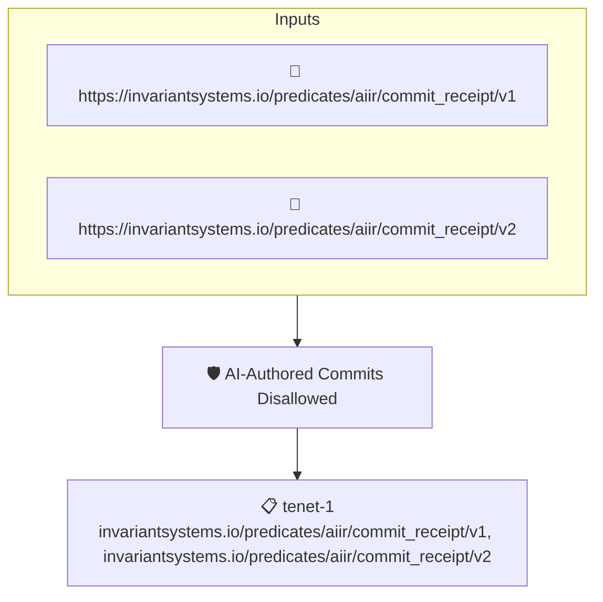

# AI-Authored Commits Disallowed

Fails when an [AIIR](https://invariantsystems.io) commit receipt marks the attested commit as AI-authored, or when the receipt does not state its authorship at all. Both the v1 and the wrapped v2 receipt predicates are accepted.

## Overview

| Property | Value |
|----------|-------|
| **Type** | Policy |
| **ID** | `aiir-ai-authored-disallowed` |
| **Assert mode** | AND |
| **Tenets** | 1 |
| **Enforce** | ON |

## Structure



## Tenets

### Tenet: `tenet-1`

**Attestation types:**
- `https://invariantsystems.io/predicates/aiir/commit_receipt/v1`
- `https://invariantsystems.io/predicates/aiir/commit_receipt/v2`

**Evaluation:**
```cel
outputs.hasAiAuthoredStatus && !outputs.isAiAuthored
```

**Outputs:**
- `authorshipClass`: `has(predicate.data.ai_attestation) && has(predicate.data.ai_attestation.autho...`
- `hasAiAuthoredStatus`: `has(predicate.data.ai_attestation) && has(predicate.data.ai_attestation.is_ai...`
- `isAiAuthored`: `has(predicate.data.ai_attestation) && has(predicate.data.ai_attestation.is_ai...`

**On pass:** AIIR receipt reports no AI-authored content

**On fail:** AI-authored content detected by AIIR or authorship status is missing
**Guidance:** This repo only accepts revisions whose AIIR receipt reports a non-AI authorship status

