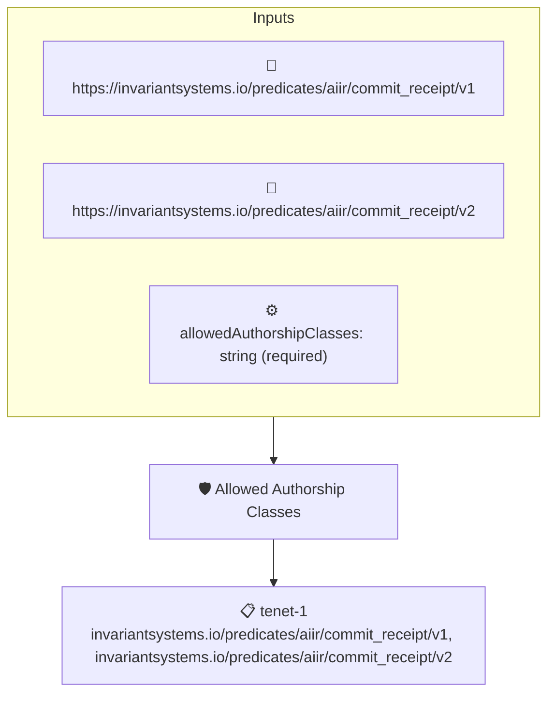

# Allowed Authorship Classes

Checks that the authorship class recorded in an AIIR commit receipt is one of the classes allowed by the `allowedAuthorshipClasses` context value, a pipe-separated list. A project can, for example, admit human-authored and AI-assisted commits while rejecting fully AI-authored ones.

## Overview

| Property | Value |
|----------|-------|
| **Type** | Policy |
| **ID** | `aiir-authorship-class-allowed` |
| **Assert mode** | AND |
| **Tenets** | 1 |
| **Enforce** | ON |

## Context Values

| Name | Type | Required | Default |
|------|------|----------|---------|
| `allowedAuthorshipClasses` | string | **yes** |  |

## Structure



## Tenets

### Tenet: `tenet-1`

**Attestation types:**
- `https://invariantsystems.io/predicates/aiir/commit_receipt/v1`
- `https://invariantsystems.io/predicates/aiir/commit_receipt/v2`

**Evaluation:**
```cel
outputs.authorshipClass != '' && context.allowedAuthorshipClasses.split('|').exists(authorshipClass, authorshipClass == outputs.authorshipClass)
```

**Outputs:**
- `authorshipClass`: `has(predicate.data.ai_attestation) && has(predicate.data.ai_attestation.autho...`

**On pass:** AIIR authorship class {{ .Outputs.authorshipClass }} is allowed

**On fail:** AIIR authorship class is not allowed
**Guidance:** AuthorshipClass {{ .Outputs.authorshipClass }} is not allowed for revisions in this repo

