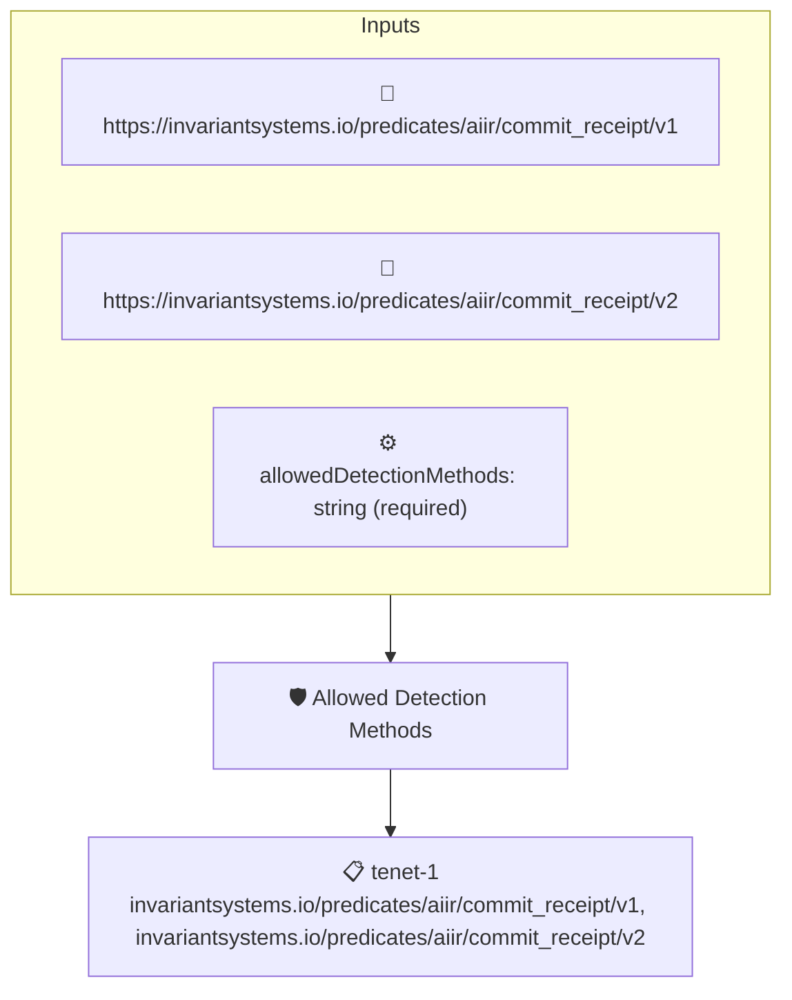

# Allowed Detection Methods

Checks that the method an AIIR commit receipt used to determine authorship is one of the methods allowed by the `allowedDetectionMethods` context value, a pipe-separated list. Projects that only trust certain detection methods can enforce that preference here.

## Overview

| Property | Value |
|----------|-------|
| **Type** | Policy |
| **ID** | `aiir-detection-method-allowed` |
| **Assert mode** | AND |
| **Tenets** | 1 |
| **Enforce** | ON |

## Context Values

| Name | Type | Required | Default |
|------|------|----------|---------|
| `allowedDetectionMethods` | string | **yes** |  |

## Structure



## Tenets

### Tenet: `tenet-1`

**Attestation types:**
- `https://invariantsystems.io/predicates/aiir/commit_receipt/v1`
- `https://invariantsystems.io/predicates/aiir/commit_receipt/v2`

**Evaluation:**
```cel
outputs.detectionMethod != '' && context.allowedDetectionMethods.split('|').exists(detectionMethod, detectionMethod == outputs.detectionMethod)
```

**Outputs:**
- `detectionMethod`: `has(predicate.data.ai_attestation) && has(predicate.data.ai_attestation.detec...`

**On pass:** AIIR detection method {{ .Outputs.detectionMethod }} is allowed

**On fail:** AIIR detection method is not allowed
**Guidance:** This repo does not accept revisions whose AIIR receipt uses detection method {{ .Outputs.detectionMethod }}

