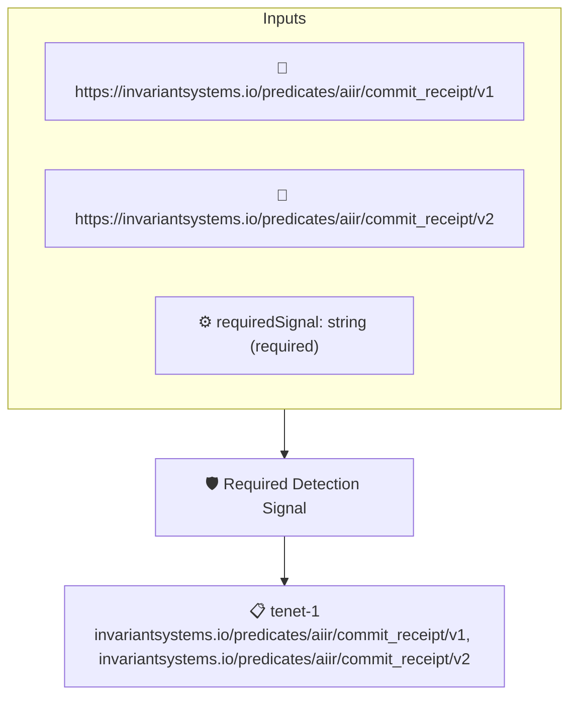

# Required Detection Signal

Checks that an AIIR commit receipt lists the detection signal named by the `requiredSignal` context value among the signals that informed its authorship decision.

## Overview

| Property | Value |
|----------|-------|
| **Type** | Policy |
| **ID** | `aiir-signal-detected` |
| **Assert mode** | AND |
| **Tenets** | 1 |
| **Enforce** | ON |

## Context Values

| Name | Type | Required | Default |
|------|------|----------|---------|
| `requiredSignal` | string | **yes** |  |

## Structure



## Tenets

### Tenet: `tenet-1`

**Attestation types:**
- `https://invariantsystems.io/predicates/aiir/commit_receipt/v1`
- `https://invariantsystems.io/predicates/aiir/commit_receipt/v2`

**Evaluation:**
```cel
outputs.matchedSignal != ''
```

**Outputs:**
- `matchedSignal`: `has(predicate.data.ai_attestation) && has(predicate.data.ai_attestation.signa...`

**On pass:** AIIR signal {{ .Outputs.matchedSignal }} was detected

**On fail:** Required AIIR signal was not detected
**Guidance:** This repo requires the AIIR receipt to include the detection signal expected by the verifier policy

