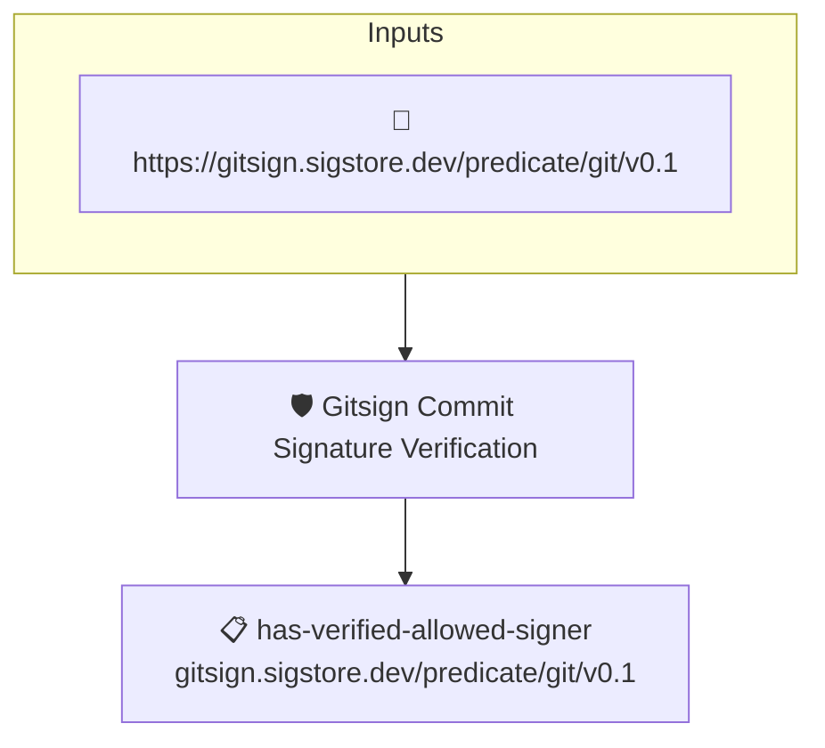

# Gitsign Commit Signature Verification

Passes when the subject git commit carries a verified gitsign
(sigstore) signature from an accepted signer.

The carabiner gitsign collector reads the commit's sigstore
signature, cryptographically verifies it (the Fulcio certificate
chain and Rekor transparency-log inclusion), and emits a gitsign
commit attestation (`https://gitsign.sigstore.dev/predicate/git/v0.1`)
carrying the verified signer identity. AMPEL matches that signer
against the identities supplied at verification time (`--signer`) or
declared in a policy `identities` block, and only admits attestations
from an accepted signer. This tenet then asserts that at least one
such attestation is present **and** that its matched signer identity
is set and is a sigstore identity — so a signer must be pinned (an
empty match, or a key/reference identity, is rejected).

## Verifying

The signer identity is enforced by AMPEL, not by the tenet code, so
supply the expected signer with `--signer`:

```
ampel verify --subject-hash sha1:<commit-sha> \
    -c gitsign:git+https://github.com/ORG/REPO \
    -p git+https://github.com/carabiner-dev/policies#sigstore/gitsign-commit-signature.hjson \
    --signer 'sigstore::https://accounts.google.com::committer@example.com'
```

Alternatively, pin the accepted signer(s) directly in the policy by
adding an `identities` block (sigstore `mode: regexp` lets a single
entry match a whole org).

## Overview

| Property | Value |
|----------|-------|
| **Type** | Policy |
| **ID** | `gitsign-commit-signature` |
| **Assert mode** | AND |
| **Tenets** | 1 |
| **Enforce** | ON |

## Structure



## Tenets

### Tenet: `has-verified-allowed-signer`

**Attestation types:**
- `https://gitsign.sigstore.dev/predicate/git/v0.1`

**Evaluation:**
```cel
predicates.exists(p,
    p.verification.verified &&
    size(p.verification.identities) > 0 &&
    p.verification.identities.all(i, has(i.sigstore))
)
```

**On pass:** The commit is gitsign-signed by an accepted sigstore signer

**On fail:** The commit is not signed by an accepted sigstore signer
**Guidance:** The commit must carry a verified gitsign (sigstore) signature whose signer matches an accepted sigstore identity. Pass the expected identity with --signer 'sigstore::<issuer>::<identity>' (or declare it in the policy) — a key or reference identity, or no identity at all, is rejected.

