# CISA 2026 SBOM Minimum Elements

Checks an SBOM's conformance to the data field elements of the
2026 Minimum Elements for a Software Bill of Materials (SBOM),
published by CISA and partner agencies on July 29, 2026. The
document updates and replaces the 2021 NTIA SBOM Minimum
Elements.

The group defines one block per minimum element, covering the
nine SBOM Metadata elements and the eight Component Data
elements. Each block can host one or more policies verifying its
element; all blocks must pass for the SBOM to conform.

The Practices and Processes elements of the document describe
organizational behavior and are not verifiable against a single
SBOM document, so they are not part of this group.

All blocks reference the standalone policies under protobom/,
pinned at commit 3c00b05.

## Overview

| Property | Value |
|----------|-------|
| **Type** | PolicyGroup |
| **ID** | `CISA-SBOM-2026` |
| **Version** | 1 |
| **Blocks** | 17 |
| **Enforce** | ON |

## Structure

```mermaid
flowchart TD
    G["📂 CISA-SBOM-2026"]
    G --> G_M{"ALL blocks must pass"}
    G_M --> G_B0["⚡ sbom-author"]
    G_B0 --> G_B0_P0["🛡️ PROTOBOM-AUTHOR"]
    G_M --> G_B1["⚡ sbom-author-signature"]
    G_B1 --> G_B1_P0["🛡️ PROTOBOM-SBOM-SIGNED"]
    G_M --> G_B2["⚡ sbom-data-format-name"]
    G_B2 --> G_B2_P0["🛡️ PROTOBOM-SBOM-FORMAT-NAME"]
    G_M --> G_B3["⚡ sbom-data-format-version"]
    G_B3 --> G_B3_P0["🛡️ PROTOBOM-SBOM-FORMAT-VERSION"]
    G_M --> G_B4["⚡ sbom-generation-context"]
    G_B4 --> G_B4_P0["🛡️ PROTOBOM-SBOM-GENERATION-CONTEXT"]
    G_M --> G_B5["⚡ sbom-timestamp"]
    G_B5 --> G_B5_P0["🛡️ PROTOBOM-TIMESTAMP"]
    G_M --> G_B6["⚡ sbom-tool-name"]
    G_B6 --> G_B6_P0["🛡️ PROTOBOM-SBOM-TOOL-NAME"]
    G_M --> G_B7["⚡ sbom-tool-version"]
    G_B7 --> G_B7_P0["🛡️ PROTOBOM-SBOM-TOOL-VERSION"]
    G_M --> G_B8["⚡ sbom-version"]
    G_B8 --> G_B8_P0["🛡️ PROTOBOM-SBOM-DOC-VERSION"]
    G_M --> G_B9["⚡ component-producer"]
    G_B9 --> G_B9_P0["🛡️ PROTOBOM-SBOM-PRODUCERS"]
    G_M --> G_B10["⚡ component-dependency-relationship"]
    G_B10 --> G_B10_P0["🛡️ PROTOBOM-RELATONSHIPS"]
    G_M --> G_B11["⚡ component-hash-value"]
    G_B11 --> G_B11_P0["🛡️ PROTOBOM-SBOM-HASHES"]
    G_M --> G_B12["⚡ component-hash-algorithm"]
    G_B12 --> G_B12_P0["🛡️ PROTOBOM-SBOM-HASH-ALGORITHMS"]
    G_M --> G_B13["⚡ component-identifiers"]
    G_B13 --> G_B13_P0["🛡️ PROTOBOM-IDENTIFIERS"]
    G_M --> G_B14["⚡ component-license"]
    G_B14 --> G_B14_P0["🛡️ PROTOBOM-SBOM-LICENSES"]
    G_M --> G_B15["⚡ component-name"]
    G_B15 --> G_B15_P0["🛡️ PROTOBOM-NAME"]
    G_M --> G_B16["⚡ component-version"]
    G_B16 --> G_B16_P0["🛡️ PROTOBOM-SBOM-VERSIONS"]
```



## Block: `sbom-author` (assert: AND)

### Policy: `PROTOBOM-AUTHOR`

SBOM has author data

#### Overview

| Property | Value |
|----------|-------|
| **Type** | Policy |
| **ID** | `PROTOBOM-AUTHOR` |
| **Assert mode** | AND |
| **Tenets** | 1 |
| **Enforce** | ON |

#### Tenets

##### Tenet: `tenet-1`

**Evaluation:**
```cel
size(outputs.authors) > 0
```

**Outputs:**
- `authors`: `size(sboms) > 0 ? sboms[0].get_authors() : []`

**On pass:** SBOM author defined


## Block: `sbom-author-signature` (assert: AND)

### Policy: `PROTOBOM-SBOM-SIGNED`

# SBOM Author Signature

Checks that the SBOM was ingested from a signed attestation and that
AMPEL verified its signature. This implements the _SBOM Author
Signature_ element of the CISA 2026 SBOM Minimum Elements.

Note that this policy checks the signature on the attestation
envelope wrapping the SBOM, not data inside the SBOM document
itself (neither SPDX nor CycloneDX embed author signatures).

This standalone policy enforces the signature requirement. As most
SBOMs are still distributed unsigned, the CISA-SBOM-2026 group
carries it with enforce OFF to make the check advisory; set
`enforce: OFF` (or pin author identities) to match that behavior.

#### Overview

| Property | Value |
|----------|-------|
| **Type** | Policy |
| **ID** | `PROTOBOM-SBOM-SIGNED` |
| **Assert mode** | AND |
| **Tenets** | 1 |
| **Enforce** | OFF |

#### Tenets

##### Tenet: `signed`

**Evaluation:**
```cel
size(predicates) > 0 && predicates.all(p, size(p.verification.signers) > 0)
```

**On pass:** SBOM attestation signature verified

**On fail:** The SBOM attestation is not signed or its signature could not be verified
**Guidance:** Distribute the SBOM wrapped in a signed attestation (for example a sigstore bundle) attributable to the SBOM author


## Block: `sbom-data-format-name` (assert: AND)

### Policy: `PROTOBOM-SBOM-FORMAT-NAME`

# SBOM Data Format Name

Checks that the SBOM is expressed in one of the widely used,
machine-processable SBOM data formats: SPDX or CycloneDX. This
implements the _SBOM Data Format Name_ element of the CISA 2026
SBOM Minimum Elements.

The format is read from the source data protobom captures when
ingesting the SBOM (for example `text/spdx+json;version=2.3`).

#### Overview

| Property | Value |
|----------|-------|
| **Type** | Policy |
| **ID** | `PROTOBOM-SBOM-FORMAT-NAME` |
| **Assert mode** | AND |
| **Tenets** | 1 |
| **Enforce** | ON |

#### Tenets

##### Tenet: `format-name`

**Evaluation:**
```cel
outputs.format.startsWith('text/spdx') || outputs.format.startsWith('application/vnd.cyclonedx')
```

**Outputs:**
- `format`: `size(sboms) > 0 ? sboms[0].get_metadata().source_data.format : ''`

**On pass:** SBOM data format identified

**On fail:** No SBOM in a widely used machine-processable data format was found
**Guidance:** Provide the SBOM as an SPDX or CycloneDX document


## Block: `sbom-data-format-version` (assert: AND)

### Policy: `PROTOBOM-SBOM-FORMAT-VERSION`

# SBOM Data Format Version

Checks that the version of the SBOM's data format can be
determined. This implements the _SBOM Data Format Version_ element
of the CISA 2026 SBOM Minimum Elements.

The version is read from the format string protobom captures when
ingesting the SBOM (for example `text/spdx+json;version=2.3` or
`application/vnd.cyclonedx+json;version=1.6`).

#### Overview

| Property | Value |
|----------|-------|
| **Type** | Policy |
| **ID** | `PROTOBOM-SBOM-FORMAT-VERSION` |
| **Assert mode** | AND |
| **Tenets** | 1 |
| **Enforce** | ON |

#### Tenets

##### Tenet: `format-version`

**Evaluation:**
```cel
outputs.format.contains(';version=') && !outputs.format.endsWith('=')
```

**Outputs:**
- `format`: `size(sboms) > 0 ? sboms[0].get_metadata().source_data.format : ''`

**On pass:** SBOM data format version identified

**On fail:** The version of the SBOM's data format could not be determined
**Guidance:** Generate the SBOM in a versioned release of SPDX or CycloneDX


## Block: `sbom-generation-context` (assert: AND)

### Policy: `PROTOBOM-SBOM-GENERATION-CONTEXT`

# SBOM Generation Context

Checks that the SBOM declares the software lifecycle phase it was
generated in (before build, build, after build, etc). This
implements the _SBOM Generation Context_ element of the CISA 2026
SBOM Minimum Elements.

CycloneDX captures this in `metadata.lifecycles`, which protobom
maps to the document types. SPDX 2.x has no equivalent field, so
SPDX documents are exempted from the check: the policy passes when
the SBOM is SPDX and requires at least one declared lifecycle
phase when it is CycloneDX.

This policy uses the protobom transformer because the lifecycle
data is only reachable through the transformed predicate.

#### Overview

| Property | Value |
|----------|-------|
| **Type** | Policy |
| **ID** | `PROTOBOM-SBOM-GENERATION-CONTEXT` |
| **Assert mode** | AND |
| **Tenets** | 1 |
| **Enforce** | ON |

#### Tenets

##### Tenet: `generation-context`

**Attestation types:**
- `application/protobom`

**Evaluation:**
```cel
outputs.format.startsWith('text/spdx') || size(outputs.lifecycles) > 0
```

**Outputs:**
- `format`: `size(predicates) > 0 && has(predicates[0].data.metadata.sourceData) ? predica...`
- `lifecycles`: `size(predicates) > 0 && has(predicates[0].data.metadata.documentTypes) ? pred...`

**On pass:** SBOM declares its generation context

**On fail:** The SBOM does not declare the lifecycle phase it was generated in
**Guidance:** Record the generation context in the CycloneDX metadata.lifecycles field (for example: build)


## Block: `sbom-timestamp` (assert: AND)

### Policy: `PROTOBOM-TIMESTAMP`

SBOM has a timestamp

#### Overview

| Property | Value |
|----------|-------|
| **Type** | Policy |
| **ID** | `PROTOBOM-TIMESTAMP` |
| **Assert mode** | AND |
| **Tenets** | 1 |
| **Enforce** | ON |

#### Tenets

##### Tenet: `tenet-1`

**Evaluation:**
```cel
int(outputs.date) > 0
```

**Outputs:**
- `date`: `size(sboms) > 0 ? sboms[0].get_metadata().date : null`

**On pass:** SBOM contains a timestamp


## Block: `sbom-tool-name` (assert: AND)

### Policy: `PROTOBOM-SBOM-TOOL-NAME`

# SBOM Tool Name

Checks that the SBOM records the name of the tool used to generate
it. This implements the _SBOM Tool Name_ element of the CISA 2026
SBOM Minimum Elements.

This policy uses the protobom transformer because the tool
metadata is only reachable through the transformed predicate.

Note: protobom does not yet populate the tools collection when
reading CycloneDX documents, so CycloneDX SBOMs currently fail
this check even when `metadata.tools` is set.

#### Overview

| Property | Value |
|----------|-------|
| **Type** | Policy |
| **ID** | `PROTOBOM-SBOM-TOOL-NAME` |
| **Assert mode** | AND |
| **Tenets** | 1 |
| **Enforce** | ON |

#### Tenets

##### Tenet: `tool-name`

**Attestation types:**
- `application/protobom`

**Evaluation:**
```cel
size(outputs.tools) > 0 && outputs.tools.all(t, has(t.name) && t.name != '')
```

**Outputs:**
- `tools`: `size(predicates) > 0 && has(predicates[0].data.metadata.tools) ? predicates[0...`

**On pass:** SBOM records the tool that generated it

**On fail:** The SBOM does not record the name of the tool that generated it
**Guidance:** Record the generator in the SBOM metadata (SPDX Tool creator or CycloneDX metadata.tools)


## Block: `sbom-tool-version` (assert: AND)

### Policy: `PROTOBOM-SBOM-TOOL-VERSION`

# SBOM Tool Version

Checks that the SBOM records the version of the tool used to
generate it. This implements the _SBOM Tool Version_ element of
the CISA 2026 SBOM Minimum Elements.

SPDX encodes the tool version in the creator string by convention
(`Tool: name-version`) and protobom does not yet split it out, so
a tool entry also passes when its name embeds a version.

This policy uses the protobom transformer because the tool
metadata is only reachable through the transformed predicate.

Note: protobom does not yet populate the tools collection when
reading CycloneDX documents, so CycloneDX SBOMs currently fail
this check even when `metadata.tools` is set.

#### Overview

| Property | Value |
|----------|-------|
| **Type** | Policy |
| **ID** | `PROTOBOM-SBOM-TOOL-VERSION` |
| **Assert mode** | AND |
| **Tenets** | 1 |
| **Enforce** | ON |

#### Tenets

##### Tenet: `tool-version`

**Attestation types:**
- `application/protobom`

**Evaluation:**
```cel
size(outputs.tools) > 0 && outputs.tools.all(t, (has(t.version) && t.version != '') || (has(t.name) && t.name.matches('.*[-_/ ]v?[0-9].*')))
```

**Outputs:**
- `tools`: `size(predicates) > 0 && has(predicates[0].data.metadata.tools) ? predicates[0...`

**On pass:** SBOM records the version of the tool that generated it

**On fail:** The SBOM does not record the version of the tool that generated it
**Guidance:** Record the generator version in the SBOM metadata (SPDX Tool creator string or CycloneDX metadata.tools)


## Block: `sbom-version` (assert: AND)

### Policy: `PROTOBOM-SBOM-DOC-VERSION`

# SBOM Version

Checks that the SBOM document itself is versioned, either through
a version identifier or through a unique document identifier
(serial number). This implements the _SBOM Version_ element of the
CISA 2026 SBOM Minimum Elements, which admits both semantic
versions and RFC 9562 style unique identifiers.

CycloneDX captures this in the document `version` and
`serialNumber` fields. SPDX conveys it through the unique document
namespace.

Not to be confused with PROTOBOM-SBOM-VERSIONS, which checks the
versions of the components listed in the SBOM.

#### Overview

| Property | Value |
|----------|-------|
| **Type** | Policy |
| **ID** | `PROTOBOM-SBOM-DOC-VERSION` |
| **Assert mode** | AND |
| **Tenets** | 1 |
| **Enforce** | ON |

#### Tenets

##### Tenet: `doc-version`

**Evaluation:**
```cel
(outputs.version != '' && outputs.version != '0') || outputs.identifier != ''
```

**Outputs:**
- `identifier`: `size(sboms) > 0 ? sboms[0].get_metadata().id : ''`
- `version`: `size(sboms) > 0 ? sboms[0].get_metadata().version : ''`

**On pass:** SBOM document is versioned

**On fail:** The SBOM document has no version or unique identifier
**Guidance:** Set the CycloneDX version/serialNumber or the SPDX document namespace to identify this revision of the SBOM


## Block: `component-producer` (assert: AND)

### Policy: `PROTOBOM-SBOM-PRODUCERS`

# Component Producer

Checks that the top level components of the SBOM identify the
entity that created them. This implements the _Component Producer_
element of the CISA 2026 SBOM Minimum Elements, which replaces the
2021 _Supplier Name_ element.

The check looks at each root component's originators and falls
back to its suppliers, as most SBOM generators record the
producing entity in the supplier field.

Note: protobom does not yet populate supplier data when reading
CycloneDX documents, so CycloneDX SBOMs currently fail this check
even when the component supplier is set.

#### Overview

| Property | Value |
|----------|-------|
| **Type** | Policy |
| **ID** | `PROTOBOM-SBOM-PRODUCERS` |
| **Assert mode** | AND |
| **Tenets** | 1 |
| **Enforce** | ON |

#### Tenets

##### Tenet: `producers`

**Evaluation:**
```cel
size(outputs.producers) > 0 && outputs.producers.all(p, size(p) > 0 && p.all(e, e.name != ''))
```

**Outputs:**
- `producers`: `size(sboms) > 0 ? sboms[0].get_node_list().get_root_nodes().map(n, size(n.ori...`

**On pass:** All top level components identify their producer

**On fail:** One or more top level components do not identify the entity that produced them
**Guidance:** Set the originator (SPDX) or supplier of each top level component, or explicitly mark it as of unknown provenance


## Block: `component-dependency-relationship` (assert: AND)

### Policy: `PROTOBOM-RELATONSHIPS`

Dependency relationships

#### Overview

| Property | Value |
|----------|-------|
| **Type** | Policy |
| **ID** | `PROTOBOM-RELATONSHIPS` |
| **Assert mode** | AND |
| **Tenets** | 1 |
| **Enforce** | OFF |

#### Tenets

##### Tenet: `tenet-1`

**Evaluation:**
```cel
outputs.descendants.all(nl, size(nl.get_edges()) > 0)
```

**Outputs:**
- `descendants`: `sboms[0].get_node_list().get_root_nodes().map(n, sboms[0].get_node_list().get...`

**On pass:** All top level components have depedency relationships


## Block: `component-hash-value` (assert: AND)

### Policy: `PROTOBOM-SBOM-HASHES`

# Component Hash Value

Checks that the top level components of the SBOM carry at least
one cryptographic hash of the component artifact. This implements
the _Component Hash Value_ element of the CISA 2026 SBOM Minimum
Elements.

#### Overview

| Property | Value |
|----------|-------|
| **Type** | Policy |
| **ID** | `PROTOBOM-SBOM-HASHES` |
| **Assert mode** | AND |
| **Tenets** | 1 |
| **Enforce** | ON |

#### Tenets

##### Tenet: `hashes`

**Evaluation:**
```cel
size(outputs.hashes) > 0 && outputs.hashes.all(h, size(h) > 0 && h.all(alg, h[alg] != ''))
```

**Outputs:**
- `hashes`: `size(sboms) > 0 ? sboms[0].get_node_list().get_root_nodes().map(n, n.hashes) ...`

**On pass:** All top level components have hash values

**On fail:** One or more top level components have no cryptographic hash of the component artifact
**Guidance:** Add checksums (SPDX) or hashes (CycloneDX) to each top level component, or explicitly mark the hash as unknown


## Block: `component-hash-algorithm` (assert: AND)

### Policy: `PROTOBOM-SBOM-HASH-ALGORITHMS`

# Component Hash Algorithm

Checks that the hashes of the SBOM's top level components identify
the cryptographic algorithm that produced them. This implements
the _Component Hash Algorithm_ element of the CISA 2026 SBOM
Minimum Elements.

Protobom normalizes hash algorithm names when ingesting the SBOM,
so the check requires every hash entry to be keyed by a recognized
algorithm.

#### Overview

| Property | Value |
|----------|-------|
| **Type** | Policy |
| **ID** | `PROTOBOM-SBOM-HASH-ALGORITHMS` |
| **Assert mode** | AND |
| **Tenets** | 1 |
| **Enforce** | ON |

#### Tenets

##### Tenet: `hash-algorithms`

**Evaluation:**
```cel
size(outputs.hashes) > 0 && outputs.hashes.all(h, size(h) > 0 && h.all(alg, alg != 'UNKNOWN'))
```

**Outputs:**
- `hashes`: `size(sboms) > 0 ? sboms[0].get_node_list().get_root_nodes().map(n, n.hashes) ...`

**On pass:** All top level component hashes identify their algorithm

**On fail:** One or more top level components have no hash keyed by a recognized cryptographic algorithm
**Guidance:** Identify the hash algorithm of each component checksum using standard algorithm names (for example SHA256)


## Block: `component-identifiers` (assert: AND)

### Policy: `PROTOBOM-IDENTIFIERS`

Software identifiers

#### Overview

| Property | Value |
|----------|-------|
| **Type** | Policy |
| **ID** | `PROTOBOM-IDENTIFIERS` |
| **Assert mode** | AND |
| **Tenets** | 1 |
| **Enforce** | ON |

#### Tenets

##### Tenet: `tenet-1`

**Evaluation:**
```cel
outputs.identifiers.all(s, size(s) > 0)
```

**Outputs:**
- `identifiers`: `sboms[0].get_node_list().get_root_nodes().map(n, n.identifiers)`

**On pass:** Top level components have software identifiers


## Block: `component-license` (assert: AND)

### Policy: `PROTOBOM-SBOM-LICENSES`

# Component License

Checks that the top level components of the SBOM carry license
information. This implements the _Component License_ element of
the CISA 2026 SBOM Minimum Elements.

The check accepts declared license lists or a concluded license on
each root component. Explicit unknown markers (such as SPDX
NOASSERTION) satisfy the element, as CISA requires unknown license
information to be explicitly indicated rather than omitted.

This policy only checks for the presence of license data. To
enforce that licenses are OSI/FSF approved, pair it with
sbom-licenses-are-foss.

#### Overview

| Property | Value |
|----------|-------|
| **Type** | Policy |
| **ID** | `PROTOBOM-SBOM-LICENSES` |
| **Assert mode** | AND |
| **Tenets** | 1 |
| **Enforce** | ON |

#### Tenets

##### Tenet: `licenses`

**Evaluation:**
```cel
size(outputs.licenses) > 0 && outputs.licenses.all(l, size(l) > 0 && l.all(x, x != ''))
```

**Outputs:**
- `licenses`: `size(sboms) > 0 ? sboms[0].get_node_list().get_root_nodes().map(n, size(n.lic...`

**On pass:** All top level components carry license information

**On fail:** One or more top level components carry no license information
**Guidance:** Add license identifiers to each top level component or explicitly mark the license as unknown


## Block: `component-name` (assert: AND)

### Policy: `PROTOBOM-NAME`

Top level component names

#### Overview

| Property | Value |
|----------|-------|
| **Type** | Policy |
| **ID** | `PROTOBOM-NAME` |
| **Assert mode** | AND |
| **Tenets** | 1 |
| **Enforce** | ON |

#### Tenets

##### Tenet: `tenet-1`

**Evaluation:**
```cel
outputs.names.all(s, s != "")
```

**Outputs:**
- `names`: `sboms[0].get_node_list().get_root_nodes().map(s, s.name)`

**On pass:** Top level components have their name set


## Block: `component-version` (assert: AND)

### Policy: `PROTOBOM-SBOM-VERSIONS`

Top level elements of the SBOM have version information set

#### Overview

| Property | Value |
|----------|-------|
| **Type** | Policy |
| **ID** | `PROTOBOM-SBOM-VERSIONS` |
| **Assert mode** | AND |
| **Tenets** | 1 |
| **Enforce** | ON |

#### Tenets

##### Tenet: `tenet-1`

**Evaluation:**
```cel
outputs.versions.all(s, s != "")
```

**Outputs:**
- `versions`: `sboms[0].get_node_list().get_root_nodes().map(s, s.version)`

**On pass:** All top level components have versions


