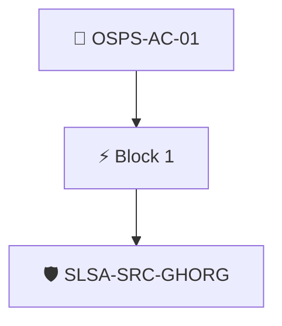

# Use MFA for Sensitive Actions

The project's version control system MUST require multi-factor authentication for collaborators modifying the project repository settings or accessing sensitive data.

Checked through the repository's SLSA source provenance with the `slsa-source/ghorg` policy, which establishes that the repository is hosted in a GitHub organization.

## Overview

| Property | Value |
|----------|-------|
| **Type** | PolicyGroup |
| **ID** | `OSPS-AC-01` |
| **Blocks** | 1 |
| **Enforce** | ON |

## Structure



## Block: `block-1` (assert: AND)

### Policy: `SLSA-SRC-GHORG`

Evaluates if athe repository is hosted in GitHub

#### Overview

| Property | Value |
|----------|-------|
| **Type** | Policy |
| **ID** | `SLSA-SRC-GHORG` |
| **Assert mode** | AND |
| **Tenets** | 1 |
| **Enforce** | ON |

#### Tenets

##### Tenet: `01`

**Attestation types:**
- `https://github.com/slsa-framework/slsa-source-poc/source-provenance/v1-draft`

**Evaluation:**
```cel
outputs.org.name.indexOf('github.com') == 0 
```

**Outputs:**
- `org`: `github.orgDescriptorFromURI(predicate.data.repoUri)`

**On pass:** GitHub organization found in SLSA provenance


