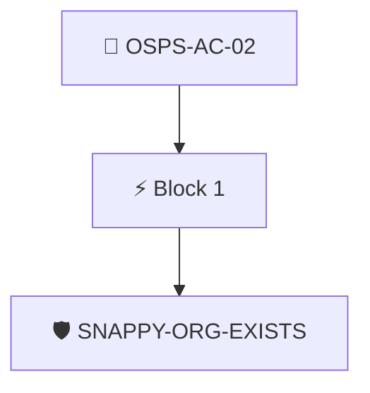

# Restrict Collaborator Permissions

The project's version control system MUST restrict collaborator permissions to the lowest available privileges by default.

Checked through the attested GitHub organization data with the `snappy/org-exists` policy.

## Overview

| Property | Value |
|----------|-------|
| **Type** | PolicyGroup |
| **ID** | `OSPS-AC-02` |
| **Blocks** | 1 |
| **Enforce** | ON |

## Structure



## Block: `block-1` (assert: AND)

### Policy: `SNAPPY-ORG-EXISTS`

Attested GitHub organization data available

#### Overview

| Property | Value |
|----------|-------|
| **Type** | Policy |
| **ID** | `SNAPPY-ORG-EXISTS` |
| **Assert mode** | AND |
| **Tenets** | 1 |
| **Enforce** | ON |

#### Tenets

##### Tenet: `01`

**Attestation types:**
- `http://github.com/carabiner-dev/snappy/specs/github/org.yaml`
- `http://github.com/carabiner-dev/snappy/specs/org.yaml`

**Evaluation:**
```cel
true
```

**On pass:** Attested GitHub organization data found


