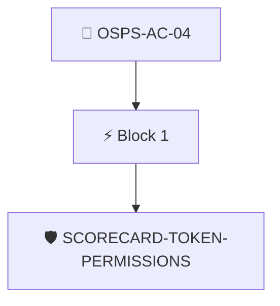

# Least Privilege for CI/CD Pipelines

The project's permissions in CI/CD pipelines MUST follow the principle of least privilege.

Checked through the attested OpenSSF Scorecard results with the `scorecard/token-permissions` policy.

## Overview

| Property | Value |
|----------|-------|
| **Type** | PolicyGroup |
| **ID** | `OSPS-AC-04` |
| **Blocks** | 1 |
| **Enforce** | ON |

## Structure



## Block: `block-1` (assert: AND)

### Policy: `SCORECARD-TOKEN-PERMISSIONS`

CI/CD pipelines MUST follow the principle of least privilege

#### Overview

| Property | Value |
|----------|-------|
| **Type** | Policy |
| **ID** | `SCORECARD-TOKEN-PERMISSIONS` |
| **Assert mode** | AND |
| **Tenets** | 1 |
| **Enforce** | OFF |

#### Tenets

##### Tenet: `01-scorecard`

**Attestation types:**
- `https://scorecard.dev/result/v0.1`

**Evaluation:**
```cel
outputs.perms.all(c, c.score == 10)
```

**Outputs:**
- `perms`: `has(predicates[0].data.checks) ? predicates[0].data.checks.filter(c, c.name =...`

**On pass:** Scorecard reports workflows are configured with least privileges

**On fail:** Scorecard detected workflows with excessivce permissions
**Guidance:** Ensure workflows drop all privileges and only escalte when needed


