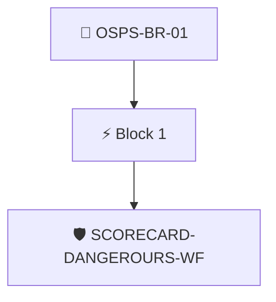

# No Untrusted Input in Build Pipelines

The project's build and release pipelines MUST NOT permit untrusted input that allows access to privileged resources.

Checked through the attested OpenSSF Scorecard results with the `scorecard/dangerous-workflow` policy.

## Overview

| Property | Value |
|----------|-------|
| **Type** | PolicyGroup |
| **ID** | `OSPS-BR-01` |
| **Blocks** | 1 |
| **Enforce** | ON |

## Structure



## Block: `block-1` (assert: AND)

### Policy: `SCORECARD-DANGEROURS-WF`

The project's build and release pipelines MUST NOT permit untrusted input

#### Overview

| Property | Value |
|----------|-------|
| **Type** | Policy |
| **ID** | `SCORECARD-DANGEROURS-WF` |
| **Assert mode** | AND |
| **Tenets** | 1 |
| **Enforce** | ON |

#### Tenets

##### Tenet: `01-scorecard`

**Attestation types:**
- `https://scorecard.dev/result/v0.1`

**Evaluation:**
```cel
outputs.bin_artifacts_checks.all(c, c.score == 10)
```

**Outputs:**
- `bin_artifacts_checks`: `has(predicates[0].data.checks) ? predicates[0].data.checks.filter(c, c.name =...`

**On pass:** Scorecard found no dangerous pipelines

**On fail:** Scorecard detected workflows with dangerous patterns
**Guidance:** Review your workflow files and look for dangerous patterns


