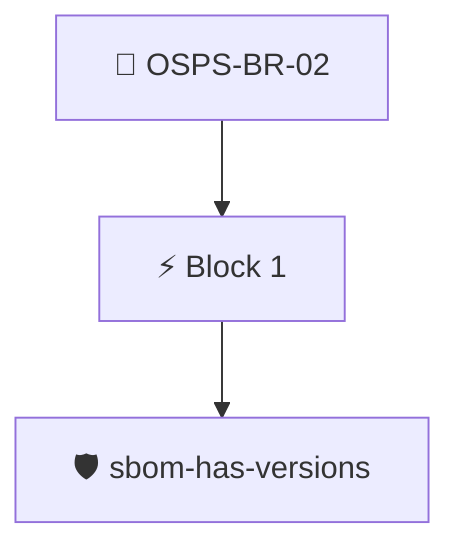

# Unique Version Identifiers

All releases and released software assets MUST be assigned a unique version identifier for each release intended to be used by users.

Checked through the release SBOM with the `sbom/sbom-has-versions` policy, which requires a version on every top-level component.

## Overview

| Property | Value |
|----------|-------|
| **Type** | PolicyGroup |
| **ID** | `OSPS-BR-02` |
| **Blocks** | 1 |
| **Enforce** | ON |

## Structure



## Block: `block-1` (assert: AND)

### Policy: `sbom-has-versions`

Checks an SBOMs top level components to ensure versions are set

#### Overview

| Property | Value |
|----------|-------|
| **Type** | Policy |
| **ID** | `sbom-has-versions` |
| **Assert mode** | AND |
| **Tenets** | 1 |
| **Enforce** | ON |

#### Tenets

##### Tenet: `01-sbom`

**Attestation types:**
- `https://spdx.dev/Document`
- `https://cyclonedx.org/bom`

**Evaluation:**
```cel
outputs.versions.all(s, s != "")
```

**Outputs:**
- `versions`: `sboms[0].get_node_list().get_root_nodes().map(s, s.version)`

**On pass:** All top level components have versions

**On fail:** Som of the top level components in the SBOM are missing versions.
**Guidance:** Ensure the SBOM generation tool is capturing the release version.


