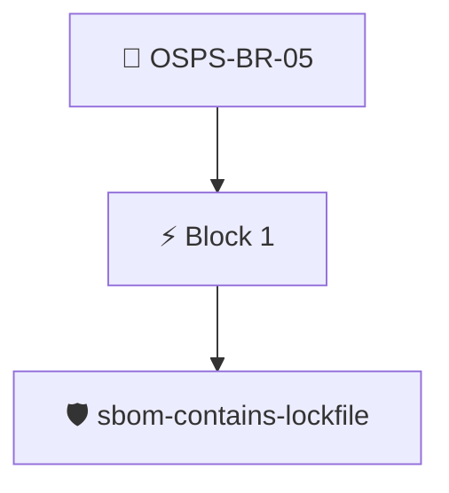

# Standardized Dependency Tooling

All build and release pipelines MUST use standardized tooling where available to ingest dependencies at build time.

Checked through the release SBOM with the `sbom/sbom-contains-lockfile` policy, which looks for a language dependency lockfile among the project's files.

## Overview

| Property | Value |
|----------|-------|
| **Type** | PolicyGroup |
| **ID** | `OSPS-BR-05` |
| **Blocks** | 1 |
| **Enforce** | ON |

## Structure



## Block: `block-1` (assert: AND)

### Policy: `sbom-contains-lockfile`

Checks for a language dependency lockfile among the SBOM files

#### Overview

| Property | Value |
|----------|-------|
| **Type** | Policy |
| **ID** | `sbom-contains-lockfile` |
| **Assert mode** | AND |
| **Tenets** | 1 |
| **Enforce** | ON |

#### Tenets

##### Tenet: `01-lockfile`

**Attestation types:**
- `https://spdx.dev/Document`
- `https://cyclonedx.org/bom`

**Evaluation:**
```cel
size(outputs["files"]) > 0
```

**Outputs:**
- `files`: `sboms[0].get_node_list().get_nodes().filter(n, (n.name == 'requirements.txt' ...`

**On pass:** Found a package lock file

**On fail:** Could not detect a package lock file
**Guidance:** Ensure your project uses go, pypy, npm or ruby gems tooling o handle dependencies


