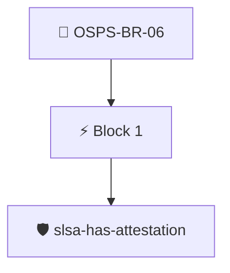

# Signed Releases

All releases MUST be signed or accounted for in a signed manifest including each asset's cryptographic hashes.

Checked with the `slsa/has-attestation` policy, which requires signed SLSA provenance for the release.

## Overview

| Property | Value |
|----------|-------|
| **Type** | PolicyGroup |
| **ID** | `OSPS-BR-06` |
| **Blocks** | 1 |
| **Enforce** | ON |

## Structure



## Block: `block-1` (assert: AND)

### Policy: `slsa-has-attestation`

Checks if a SLSA provenance attestation is available

#### Overview

| Property | Value |
|----------|-------|
| **Type** | Policy |
| **ID** | `slsa-has-attestation` |
| **Assert mode** | AND |
| **Tenets** | 1 |
| **Enforce** | ON |

#### Tenets

##### Tenet: `slsa`

**Attestation types:**
- `https://slsa.dev/provenance/v0.2`
- `https://slsa.dev/provenance/v1`

**Evaluation:**
```cel
size(predicates) > 0
```

**On pass:** SLSA provenance attestation found

**On fail:** No SLSA attestation found
**Guidance:** Capture the build process in a SLSA provenance attestation


