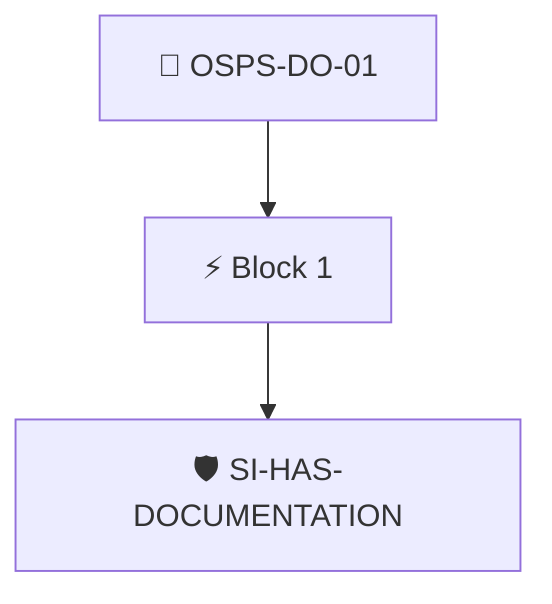

# User Guides Published

The project documentation MUST provide user guides for all basic functionality.

Checked through the project's Security Insights data with the `security-insights/has-documentation` policy.

## Overview

| Property | Value |
|----------|-------|
| **Type** | PolicyGroup |
| **ID** | `OSPS-DO-01` |
| **Blocks** | 1 |
| **Enforce** | ON |

## Structure



## Block: `block-1` (assert: AND)

### Policy: `SI-HAS-DOCUMENTATION`

Ensure the detailed-guide field in SI is populated

#### Overview

| Property | Value |
|----------|-------|
| **Type** | Policy |
| **ID** | `SI-HAS-DOCUMENTATION` |
| **Assert mode** | AND |
| **Tenets** | 2 |
| **Enforce** | ON |

#### Tenets

##### Tenet: `tenet-1`

**Attestation types:**
- `https://github.com/ossf/security-insights-spec`

**Evaluation:**
```cel
size(predicates) > 0
```

**On pass:** Security Insights attestation found

**On fail:** No Security Insights attestation found
**Guidance:** Capture your security insights flile in an attestations at build point

##### Tenet: `tenet-2`

**Attestation types:**
- `https://github.com/ossf/security-insights-spec`

**Evaluation:**
```cel
outputs["docs"] != ""
```

**Outputs:**
- `docs`: `"documentation" in predicates[0].data.project ? ("detailed-guide" in predicat...`

**On pass:** Documentation link found in SECURITY_INSIGHTS.yaml

**On fail:** No documentation link found in SI
**Guidance:** Add a security insights file to your repository and define a documentation link


