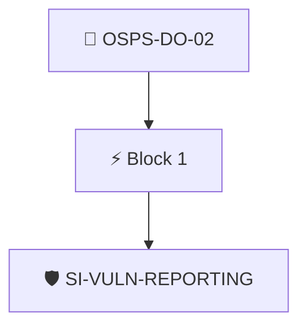

# Defect Reporting Mechanism

The project documentation MUST include a guide for reporting defects.

Checked through the project's Security Insights data with the `security-insights/vulnerability-reporting` policy.

## Overview

| Property | Value |
|----------|-------|
| **Type** | PolicyGroup |
| **ID** | `OSPS-DO-02` |
| **Blocks** | 1 |
| **Enforce** | ON |

## Structure



## Block: `block-1` (assert: AND)

### Policy: `SI-VULN-REPORTING`

Checks SI data for a vulnerability reporting link and ensures reports are accepted

#### Overview

| Property | Value |
|----------|-------|
| **Type** | Policy |
| **ID** | `SI-VULN-REPORTING` |
| **Assert mode** | AND |
| **Tenets** | 2 |
| **Enforce** | ON |

#### Tenets

##### Tenet: `tenet-1`

**Attestation types:**
- `https://github.com/ossf/security-insights-spec`

**Evaluation:**
```cel
outputs["reporting"]  
```

**Outputs:**
- `reporting`: `"vulnerability-reporting" in predicates[0].data.project ? ("reports-accepted"...`

**On pass:** Project accepts vulnerability reports according to SECURITY_INSIGHTS.yml

**On fail:** No vulnerability reports found in SI
**Guidance:** Add a security insights file to your repository and define reports-accepted as true under vulnerability-reporting

##### Tenet: `tenet-2`

**Attestation types:**
- `https://github.com/ossf/security-insights-spec`

**Evaluation:**
```cel
outputs["vulnerability-report-contact"]  
```

**Outputs:**
- `vulnerability-report-contact`: `"vulnerability-reporting" in predicates[0].data.project ? ("contact" in predi...`

**On pass:** Vulnerability report contact found

**On fail:** No contact information found in SECURITY_INSIGHTS.yml
**Guidance:** Add contact data in the project's SECURITY_INSIGHTS.yml file, under vulnerability-reporting


