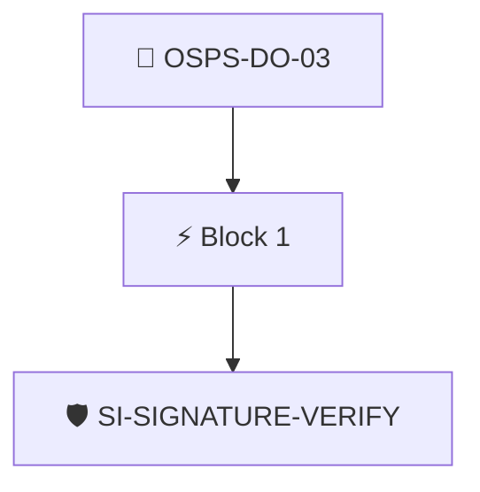

# Release Verification Instructions

The project documentation MUST provide instructions to verify the integrity and authenticity of release assets, including the expected identity of the person or process authoring the software release.

Checked through the project's Security Insights data with the `security-insights/signature-verify` policy.

## Overview

| Property | Value |
|----------|-------|
| **Type** | PolicyGroup |
| **ID** | `OSPS-DO-03` |
| **Blocks** | 1 |
| **Enforce** | ON |

## Structure



## Block: `block-1` (assert: AND)

### Policy: `SI-SIGNATURE-VERIFY`

Ensures the security insights file links a signature verification document

#### Overview

| Property | Value |
|----------|-------|
| **Type** | Policy |
| **ID** | `SI-SIGNATURE-VERIFY` |
| **Assert mode** | AND |
| **Tenets** | 1 |
| **Enforce** | ON |

#### Tenets

##### Tenet: `01-si`

**Attestation types:**
- `https://github.com/ossf/security-insights-spec`

**Evaluation:**
```cel
outputs['verify'] != '' 
```

**Outputs:**
- `verify`: `has(predicates[0].data.project) ? (has(predicates[0].data.project.documentati...`

**On pass:** Signature verification instructions found in SECURITY_INSIGHTS.yml

**On fail:** No verification instructions found in SI
**Guidance:** Point to instructions to verify your signatures in SECURITY_INSIGHTS.aml


