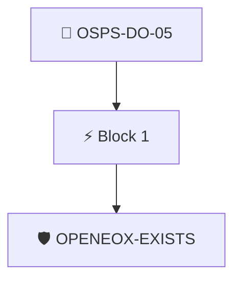

# Security Update Scope and Duration

The project documentation MUST provide a descriptive statement when releases or versions will no longer receive security updates.

Checked with the `openeox/has-openeox` policy, which requires an OpenEoX statement describing the release's end of support.

## Overview

| Property | Value |
|----------|-------|
| **Type** | PolicyGroup |
| **ID** | `OSPS-DO-05` |
| **Blocks** | 1 |
| **Enforce** | ON |

## Structure



## Block: `block-1` (assert: AND)

### Policy: `OPENEOX-EXISTS`

Ensures there is an openeox attestation

#### Overview

| Property | Value |
|----------|-------|
| **Type** | Policy |
| **ID** | `OPENEOX-EXISTS` |
| **Assert mode** | AND |
| **Tenets** | 1 |
| **Enforce** | ON |

#### Tenets

##### Tenet: `01-openeox`

**Attestation types:**
- `https://docs.oasis-open.org/openeox/core/v1.0`
- `https://docs.oasis-open.org/openeox/eox-core/v1.0`

**Evaluation:**
```cel
size(predicates) > 0
```

**On pass:** Found an OpenEoX statement with the artifact's EOS.

**On fail:** No OpenEOX data found.
**Guidance:** Capture the project End of Support in an OpenEOX file.


