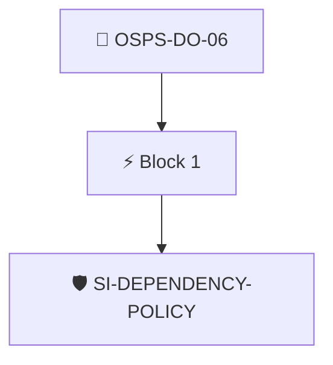

# Dependency Management Policy

The project documentation MUST include a description of how the project selects, obtains, and tracks its dependencies.

Checked through the project's Security Insights data with the `security-insights/dependency-policy` policy.

## Overview

| Property | Value |
|----------|-------|
| **Type** | PolicyGroup |
| **ID** | `OSPS-DO-06` |
| **Blocks** | 1 |
| **Enforce** | ON |

## Structure



## Block: `block-1` (assert: AND)

### Policy: `SI-DEPENDENCY-POLICY`

Checks security insights to ensure it links to a dependency policy

#### Overview

| Property | Value |
|----------|-------|
| **Type** | Policy |
| **ID** | `SI-DEPENDENCY-POLICY` |
| **Assert mode** | AND |
| **Tenets** | 1 |
| **Enforce** | ON |

#### Tenets

##### Tenet: `01-si`

**Attestation types:**
- `https://github.com/ossf/security-insights-spec`

**Evaluation:**
```cel
outputs.deppolicy != '' 
```

**Outputs:**
- `deppolicy`: `has(predicates[0].data.repository) ? (has(predicates[0].data.repository.docum...`

**On pass:** Found a link to the projects dependency policy in SECURITY_INSIGHTS.yml

**On fail:** Could not detect a dependency policy in the Security Insights file.
**Guidance:** Add a changelog entry to your SI file under repository.documentation.dependency-management-policy.


