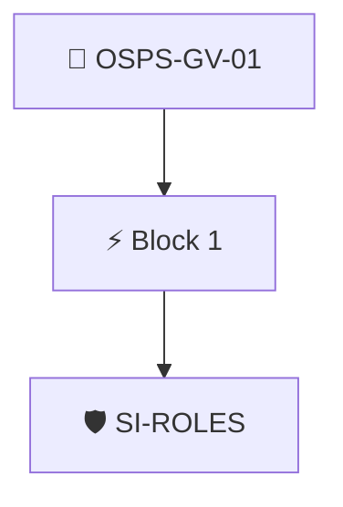

# Roles and Responsibilities Published

The project documentation MUST include the roles and responsibilities for members of the project.

Checked through the project's Security Insights data with the `security-insights/roles` policy, which requires the project administrators to be listed.

## Overview

| Property | Value |
|----------|-------|
| **Type** | PolicyGroup |
| **ID** | `OSPS-GV-01` |
| **Blocks** | 1 |
| **Enforce** | ON |

## Structure



## Block: `block-1` (assert: AND)

### Policy: `SI-ROLES`

Check the security insights file to ensure administrators are set

#### Overview

| Property | Value |
|----------|-------|
| **Type** | Policy |
| **ID** | `SI-ROLES` |
| **Assert mode** | AND |
| **Tenets** | 1 |
| **Enforce** | ON |

#### Tenets

##### Tenet: `01-si`

**Attestation types:**
- `https://github.com/ossf/security-insights-spec`

**Evaluation:**
```cel
outputs.admins.found 
```

**Outputs:**
- `admins`: `has(predicates[0].data.project) ? (has(predicates[0].data.project.administrat...`

**On pass:** Administrators listed in Securty Insights

**On fail:** Security Insights has no project administrators
**Guidance:** List the project admins in your SI yaml under repository.administrators


