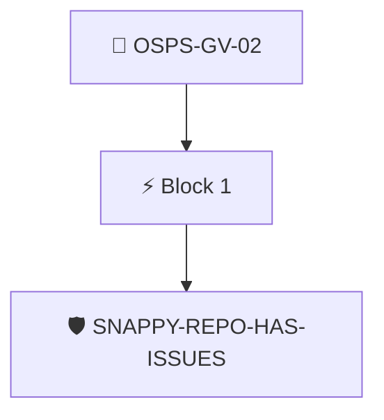

# Public Discussion Mechanisms

The project MUST have one or more mechanisms for public discussions about proposed changes and usage obstacles.

Checked through the attested repository data with the `snappy/repo-issues` policy, which requires issues to be enabled.

## Overview

| Property | Value |
|----------|-------|
| **Type** | PolicyGroup |
| **ID** | `OSPS-GV-02` |
| **Blocks** | 1 |
| **Enforce** | ON |

## Structure



## Block: `block-1` (assert: AND)

### Policy: `SNAPPY-REPO-HAS-ISSUES`

Checks if a repository has issues enabled

#### Overview

| Property | Value |
|----------|-------|
| **Type** | Policy |
| **ID** | `SNAPPY-REPO-HAS-ISSUES` |
| **Assert mode** | AND |
| **Tenets** | 2 |
| **Enforce** | ON |

#### Tenets

##### Tenet: `tenet-1`

**Attestation types:**
- `http://github.com/carabiner-dev/snappy/specs/github/repo.yaml`
- `http://github.com/carabiner-dev/snappy/specs/repo.yaml`

**Evaluation:**
```cel
size(predicates) > 0
```

**On pass:** Found attested repository data

##### Tenet: `01`

**Attestation types:**
- `http://github.com/carabiner-dev/snappy/specs/github/repo.yaml`
- `http://github.com/carabiner-dev/snappy/specs/repo.yaml`

**Evaluation:**
```cel
outputs["issues"]
```

**Outputs:**
- `issues`: `has(predicates[0].data.values.has_issues) ? predicates[0].data.values.has_iss...`

**On pass:** Issues feature is enabled in the repository

**On fail:** Issues are not enabled in the repo
**Guidance:** Turn on the issues setting in the repository


