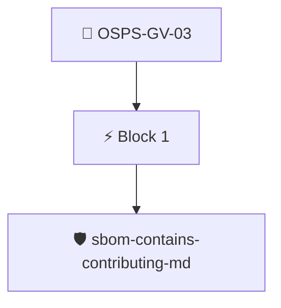

# Contribution Guide Published

The project documentation MUST include an explanation of the contribution process.

Checked through the release SBOM with the `sbom/sbom-contains-contributing-md` policy, which looks for a `CONTRIBUTING.md` file.

## Overview

| Property | Value |
|----------|-------|
| **Type** | PolicyGroup |
| **ID** | `OSPS-GV-03` |
| **Blocks** | 1 |
| **Enforce** | ON |

## Structure



## Block: `block-1` (assert: AND)

### Policy: `sbom-contains-contributing-md`

Checks for a CONTRIBUTING.md file in the SBOM

#### Overview

| Property | Value |
|----------|-------|
| **Type** | Policy |
| **ID** | `sbom-contains-contributing-md` |
| **Assert mode** | AND |
| **Tenets** | 1 |
| **Enforce** | ON |

#### Tenets

##### Tenet: `01`

**Attestation types:**
- `https://spdx.dev/Document`
- `https://cyclonedx.org/bom`

**Evaluation:**
```cel
size(outputs['files']) > 0
```

**Outputs:**
- `files`: `sboms[0].get_node_list().get_nodes().filter(n, n.name == "CONTRIBUTING.md")`

**On pass:** Found a CONTRIBUTING.md file

**On fail:** Repository has no CONTRIBUTING.md file
**Guidance:** Write up the project's contribution process into a CONTRIBUTING.md file and check it into the repository.


