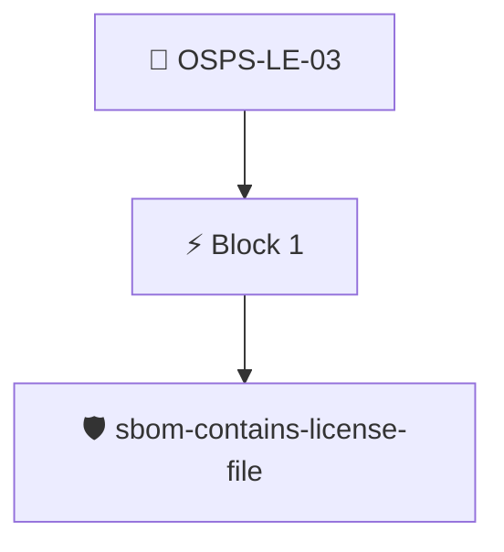

# License in a Well Known Location

All licenses for the project's source code MUST be maintained in a standard location within the project's repository.

Checked through the release SBOM with the `sbom/sbom-contains-license-file` policy, which looks for a license file among the project's files.

## Overview

| Property | Value |
|----------|-------|
| **Type** | PolicyGroup |
| **ID** | `OSPS-LE-03` |
| **Blocks** | 1 |
| **Enforce** | ON |

## Structure



## Block: `block-1` (assert: AND)

### Policy: `sbom-contains-license-file`

Locate a license file in the project files

#### Overview

| Property | Value |
|----------|-------|
| **Type** | Policy |
| **ID** | `sbom-contains-license-file` |
| **Assert mode** | AND |
| **Tenets** | 1 |
| **Enforce** | ON |

#### Tenets

##### Tenet: `01-sbom`

**Attestation types:**
- `https://spdx.dev/Document`
- `https://cyclonedx.org/bom`

**Evaluation:**
```cel
size(outputs["files"]) > 0
```

**Outputs:**
- `files`: `sboms[0].get_node_list().get_nodes().filter(n, (n.name == 'LICENSE' || n.name...`

**On pass:** Found a license file in the project's SBOM.

**On fail:** Could not detect a license file in the SBOM.
**Guidance:** Add a file named LICENSE to your project's codebase.


