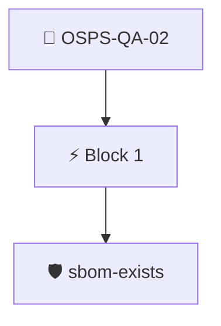

# Software Dependencies Published

The project MUST provide a list of dependencies used in the software.

Checked with the `sbom/sbom-exists` policy, which requires an attested SBOM for the release.

## Overview

| Property | Value |
|----------|-------|
| **Type** | PolicyGroup |
| **ID** | `OSPS-QA-02` |
| **Blocks** | 1 |
| **Enforce** | ON |

## Structure



## Block: `block-1` (assert: AND)

### Policy: `sbom-exists`

SBOM data found

#### Overview

| Property | Value |
|----------|-------|
| **Type** | Policy |
| **ID** | `sbom-exists` |
| **Assert mode** | OR |
| **Tenets** | 2 |
| **Enforce** | ON |

#### Tenets

##### Tenet: `tenet-1`

**Attestation types:**
- `https://spdx.dev/Document`

**Evaluation:**
```cel
size(predicates) > 0
```

**On pass:** Found attested SBOM (SPDX)

**On fail:** No SPDX SBOM found
**Guidance:** Generate an SPDX SBOM from your code

##### Tenet: `tenet-2`

**Attestation types:**
- `https://cyclonedx.org/bom`

**Evaluation:**
```cel
size(predicates) > 0
```

**On pass:** Found attested SBOM (CycloneDX)

**On fail:** No CycloneDX SBOM found
**Guidance:** Generate a CycloneDX SBOM from your code


