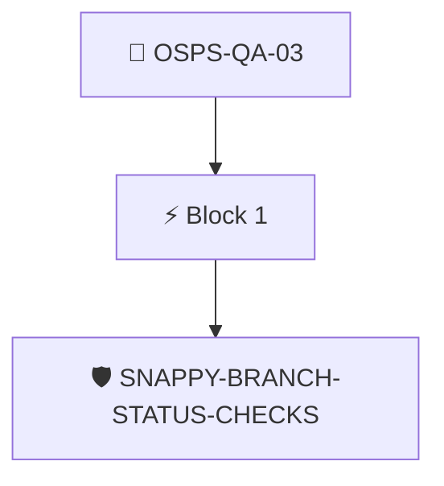

# Status Checks Before Merging

Automated status checks for commits MUST pass or be manually bypassed prior to merging into the primary branch.

Checked through the attested branch protection rules with the `snappy/branch-status-checks` policy.

## Overview

| Property | Value |
|----------|-------|
| **Type** | PolicyGroup |
| **ID** | `OSPS-QA-03` |
| **Blocks** | 1 |
| **Enforce** | ON |

## Structure



## Block: `block-1` (assert: AND)

### Policy: `SNAPPY-BRANCH-STATUS-CHECKS`

Checks for a branch rule requiring PR status checks to pass

#### Overview

| Property | Value |
|----------|-------|
| **Type** | Policy |
| **ID** | `SNAPPY-BRANCH-STATUS-CHECKS` |
| **Assert mode** | AND |
| **Tenets** | 1 |
| **Enforce** | ON |

#### Tenets

##### Tenet: `01`

**Attestation types:**
- `http://github.com/carabiner-dev/snappy/specs/github/branch-rules.yaml`
- `http://github.com/carabiner-dev/snappy/specs/branch-rules.yaml`

**Evaluation:**
```cel
has(predicates[0].data.values) ? predicates[0].data.values.exists(rule, rule.type == "required_status_checks") : false
```

**On pass:** Status checks enforced

**On fail:** Add a branch rule to ensure status checks must pass
**Guidance:** Enable "Require status checks to pass" in the repository branch rulesets


