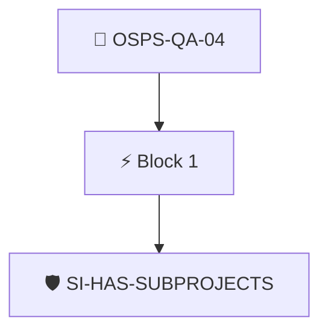

# Security Requirements on All Codebases

Any additional subproject code repositories produced by the project and compiled into a release MUST enforce the same security requirements as the primary repository.

Checked through the project's Security Insights data with the `security-insights/has-subprojects` policy.

## Overview

| Property | Value |
|----------|-------|
| **Type** | PolicyGroup |
| **ID** | `OSPS-QA-04` |
| **Blocks** | 1 |
| **Enforce** | ON |

## Structure



## Block: `block-1` (assert: AND)

### Policy: `SI-HAS-SUBPROJECTS`

project has subprojects defined in Security Insights

#### Overview

| Property | Value |
|----------|-------|
| **Type** | Policy |
| **ID** | `SI-HAS-SUBPROJECTS` |
| **Assert mode** | AND |
| **Tenets** | 1 |
| **Enforce** | ON |

#### Tenets

##### Tenet: `01-si`

**Attestation types:**
- `https://github.com/ossf/security-insights-spec`

**Evaluation:**
```cel
outputs.subprojects.found
```

**Outputs:**
- `subprojects`: `has(predicates[0].data.project) ? (has(predicates[0].data.project.repositorie...`

**On pass:** Found a changelog entry in the project's security insights file.

**On fail:** Could not find subprojects in security insights.
**Guidance:** Add a subprojects list (empty will do) to SI YAML under project.repositories


