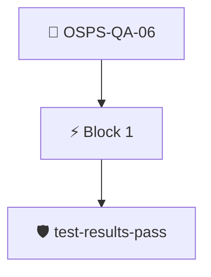

# Automated Tests in CI/CD

The project's CI/CD pipelines MUST run at least one automated test suite to ensure the changes meet expectations.

Checked with the `test-results/tests-pass` policy, which requires an attested test run with all tests passing.

## Overview

| Property | Value |
|----------|-------|
| **Type** | PolicyGroup |
| **ID** | `OSPS-QA-06` |
| **Blocks** | 1 |
| **Enforce** | ON |

## Structure



## Block: `block-1` (assert: AND)

### Policy: `test-results-pass`

Verify that test results recored in an attestation pass

#### Overview

| Property | Value |
|----------|-------|
| **Type** | Policy |
| **ID** | `test-results-pass` |
| **Assert mode** | AND |
| **Tenets** | 2 |
| **Enforce** | ON |

#### Tenets

##### Tenet: `01a`

**Attestation types:**
- `https://in-toto.io/attestation/test-result/v0.1`

**Evaluation:**
```cel
size(predicates) > 0
```

**On pass:** Attested test run found

**On fail:** No attested test runs found
**Guidance:** Generate a test-run attestation to capture the results of your unit tests

##### Tenet: `01b`

**Attestation types:**
- `https://in-toto.io/attestation/test-result/v0.1`

**Evaluation:**
```cel
outputs.result == 'pass' 
```

**Outputs:**
- `result`: `has(predicates[0].data.result) ? predicates[0].data.result : '' `

**On pass:** All attested tests are passing

**On fail:** Some of the attested test runs failed
**Guidance:** Check the output of your unit tests, ensure they are passing


