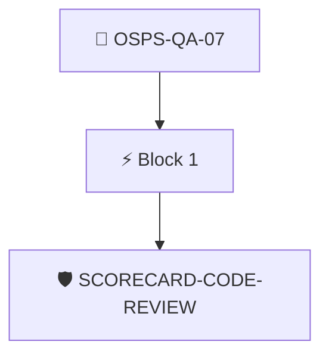

# Merge Approvals Required

The version control system MUST require at least one non-author approval of changes before merging into the primary branch.

Checked through the attested OpenSSF Scorecard results with the `scorecard/code-review` policy.

## Overview

| Property | Value |
|----------|-------|
| **Type** | PolicyGroup |
| **ID** | `OSPS-QA-07` |
| **Blocks** | 1 |
| **Enforce** | ON |

## Structure



## Block: `block-1` (assert: AND)

### Policy: `SCORECARD-CODE-REVIEW`

VCS MUST require at least one non-author approval of changes to the primary branch.

#### Overview

| Property | Value |
|----------|-------|
| **Type** | Policy |
| **ID** | `SCORECARD-CODE-REVIEW` |
| **Assert mode** | AND |
| **Tenets** | 1 |
| **Enforce** | ON |

#### Tenets

##### Tenet: `01-scorecard`

**Attestation types:**
- `https://scorecard.dev/result/v0.1`

**Evaluation:**
```cel
outputs.codereview.all(c, c.score == 10)
```

**Outputs:**
- `codereview`: `has(predicates[0].data.checks) ? predicates[0].data.checks.filter(c, c.name =...`

**On pass:** Scorecard reports code review is required for changes

**On fail:** Scorecard detected code review is not enabled in the repository
**Guidance:** Ensure your repo requires a review from another party for every pull request


