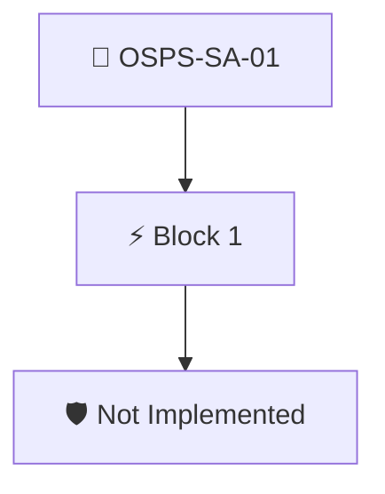

# System Design Documentation

The project documentation MUST provide design documentation demonstrating all actions and actors within the system.

Not implemented yet: AMPEL has no evidence source for this requirement, so the group is not enforced.

## Overview

| Property | Value |
|----------|-------|
| **Type** | PolicyGroup |
| **ID** | `OSPS-SA-01` |
| **Blocks** | 1 |
| **Enforce** | OFF |

## Structure



## Block: `block-1` (assert: AND)

### Not Implemented

Placeholder: AMPEL has no evidence source for this requirement yet, so this block always fails.

#### Overview

| Property | Value |
|----------|-------|
| **Type** | Policy |
| **Assert mode** | AND |
| **Tenets** | 1 |

#### Tenets

##### Tenet: `01`

**Attestation types:**
- `https://slsa.dev/provenance/v0.2`

**Evaluation:**
```cel
false
```

**On fail:** Not implemented yet
**Guidance:** We don't have a way to detect documentation about actors and actions in the system


