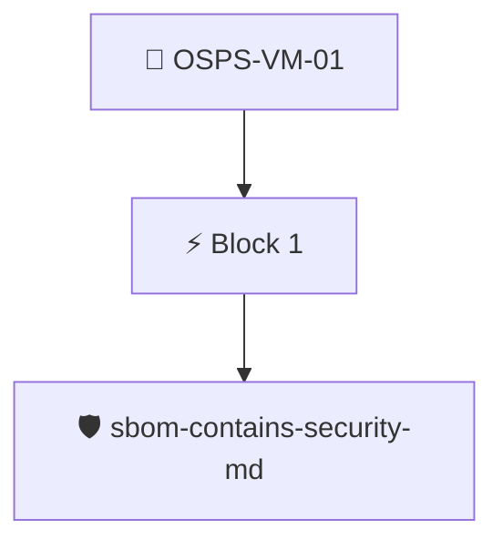

# Coordinated Vulnerability Disclosure Policy

The project documentation MUST include a policy for coordinated vulnerability disclosure, with a clear timeframe for response.

Checked through the release SBOM with the `sbom/sbom-contains-security-md` policy, which looks for a `SECURITY.md` file.

## Overview

| Property | Value |
|----------|-------|
| **Type** | PolicyGroup |
| **ID** | `OSPS-VM-01` |
| **Blocks** | 1 |
| **Enforce** | ON |

## Structure



## Block: `block-1` (assert: AND)

### Policy: `sbom-contains-security-md`

Checks an SBOM's files for a SECURITY.md file

#### Overview

| Property | Value |
|----------|-------|
| **Type** | Policy |
| **ID** | `sbom-contains-security-md` |
| **Assert mode** | AND |
| **Tenets** | 1 |
| **Enforce** | ON |

#### Tenets

##### Tenet: `01-sbom`

**Attestation types:**
- `https://spdx.dev/Document`
- `https://cyclonedx.org/bom`

**Evaluation:**
```cel
size(outputs["files"]) > 0
```

**Outputs:**
- `files`: `sboms[0].get_node_list().get_nodes().filter(n, (n.name == 'SECURITY.md' ))`

**On pass:** Found a SECURITY.md file in the project's SBOM.

**On fail:** Could not detect a SECURITY.md file in the SBOM.
**Guidance:** Add a file named SECURITY.md to your project's vulnerability disclosure policy


