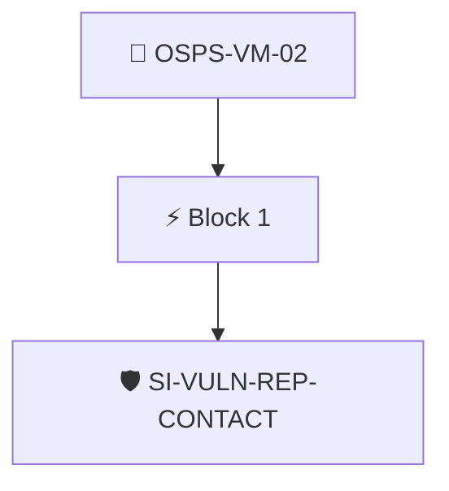

# Vulnerability Reporting Contacts

The project MUST publish contacts and process for reporting vulnerabilities.

Checked through the project's Security Insights data with the `security-insights/vulnerability-reporting-contact` policy.

## Overview

| Property | Value |
|----------|-------|
| **Type** | PolicyGroup |
| **ID** | `OSPS-VM-02` |
| **Blocks** | 1 |
| **Enforce** | ON |

## Structure



## Block: `block-1` (assert: AND)

### Policy: `SI-VULN-REP-CONTACT`

Ensures there is a contact for vulnerability reporting in SI

#### Overview

| Property | Value |
|----------|-------|
| **Type** | Policy |
| **ID** | `SI-VULN-REP-CONTACT` |
| **Assert mode** | AND |
| **Tenets** | 1 |
| **Enforce** | ON |

#### Tenets

##### Tenet: `01-si`

**Attestation types:**
- `https://github.com/ossf/security-insights-spec`

**Evaluation:**
```cel
outputs.contact != null 
```

**Outputs:**
- `contact`: `has(predicates[0].data.project) ? ('vulnerability-reporting' in predicates[0]...`

**On pass:** Found vulnerability reporting contact in Security Insights

**On fail:** No vulnerability reporting contact found in SI
**Guidance:** Add a vulnerability reporting contact under the project data in the SI yaml file


