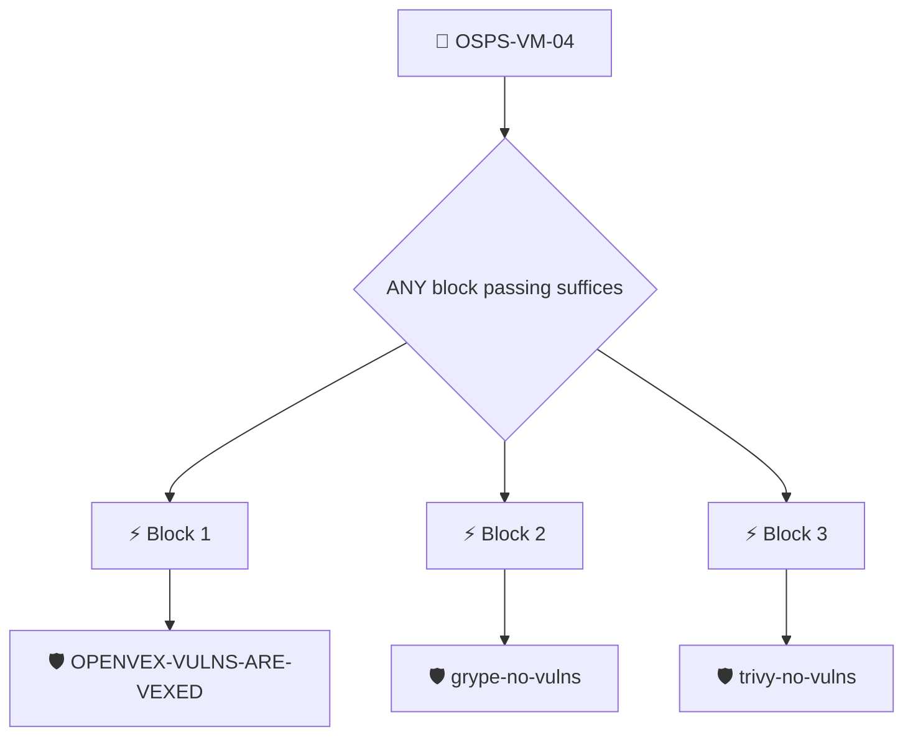

# Discovered Vulnerabilities Published

The project MUST publicly publish data about discovered vulnerabilities.

Checked with the `openvex/project-is-vexing` policy, which requires an attested vulnerability report whose findings are addressed by OpenVEX statements.

## Overview

| Property | Value |
|----------|-------|
| **Type** | PolicyGroup |
| **ID** | `OSPS-VM-04` |
| **Blocks** | 3 |
| **Enforce** | ON |

## Structure



## Block: `block-1` (assert: AND)

### Policy: `OPENVEX-VULNS-ARE-VEXED`

The project MUST publicly publish data about discovered vulnerabilities

#### Overview

| Property | Value |
|----------|-------|
| **Type** | Policy |
| **ID** | `OPENVEX-VULNS-ARE-VEXED` |
| **Assert mode** | AND |
| **Tenets** | 2 |
| **Enforce** | ON |

#### Tenets

##### Tenet: `01`

**Attestation types:**
- `https://ossf.github.io/osv-schema/results@v1`
- `https://ossf.github.io/osv-schema/results@v1.6.7`

**Evaluation:**
```cel
size(predicates) > 0
```

**On pass:** Vulnerability report published

**On fail:** A vulnerability report was found
**Guidance:** The artifact was published with an attested OSV results

##### Tenet: `02`

**Attestation types:**
- `https://ossf.github.io/osv-schema/results@v1`
- `https://ossf.github.io/osv-schema/results@v1.6.7`
- `https://openvex.dev/ns/v0.2.0`
- `https://openvex.dev/ns`

**Evaluation:**
```cel
outputs.reports > 0 && (size(outputs.vulnerabilities) == 0 || outputs.vexes > 0)
```

**Outputs:**
- `reports`: `size(predicates.filter(p, p.predicate_type.contains('osv-schema')))`
- `vexes`: `size(predicates.filter(p, p.predicate_type.contains('openvex')))`
- `vulnerabilities`: `predicates.filter(p, p.predicate_type.contains('osv-schema')).map(p, p.data.r...`

**On pass:** No vulnerabilities and/or VEX data found

**On fail:** Unvexed vulnerabilities found
**Guidance:** All vulnerabilities must be patched or accounted in VEX documents


## Block: `block-2` (assert: AND)

### Policy: `grype-no-vulns`

Ensures an attested grype vulnerability report contains no vulnerability matches

#### Overview

| Property | Value |
|----------|-------|
| **Type** | Policy |
| **ID** | `grype-no-vulns` |
| **Assert mode** | AND |
| **Tenets** | 1 |
| **Enforce** | ON |

#### Tenets

##### Tenet: `tenet-1`

**Attestation types:**
- `https://predicates.policylabs.dev/grype/v1`

**Evaluation:**
```cel
outputs.vulnCount == 0
```

**Outputs:**
- `vulnCount`: `has(predicate.data.matches) ? size(predicate.data.matches) : 0`

**On pass:** Attested grype report has no vulnerability matches

**On fail:** Attested grype report has {{ .Outputs.vulnCount }} vulnerability matches
**Guidance:** Remediate or suppress the vulnerabilities reported by grype before this policy can pass


## Block: `block-3` (assert: AND)

### Policy: `trivy-no-vulns`

Ensures an attested trivy vulnerability report contains no vulnerabilities

#### Overview

| Property | Value |
|----------|-------|
| **Type** | Policy |
| **ID** | `trivy-no-vulns` |
| **Assert mode** | AND |
| **Tenets** | 1 |
| **Enforce** | ON |

#### Tenets

##### Tenet: `tenet-1`

**Attestation types:**
- `https://predicates.policylabs.dev/trivy/v1`

**Evaluation:**
```cel
outputs.vulnCount == 0
```

**Outputs:**
- `vulnCount`: `has(predicate.data.Results) ? size(predicate.data.Results.map(r, has(r.Vulner...`

**On pass:** Attested trivy report has no vulnerabilities

**On fail:** Attested trivy report has {{ .Outputs.vulnCount }} vulnerabilities
**Guidance:** Remediate or suppress the vulnerabilities reported by trivy before this policy can pass


