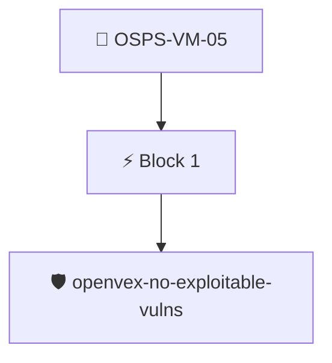

# No Exploitable Vulnerabilities

The project MUST publish and enforce a dependency remediation policy so released software carries no exploitable vulnerabilities.

Checked with the `openvex/no-exploitable-vulns-osv` policy, which fails on findings not addressed by OpenVEX statements.

## Overview

| Property | Value |
|----------|-------|
| **Type** | PolicyGroup |
| **ID** | `OSPS-VM-05` |
| **Blocks** | 1 |
| **Enforce** | ON |

## Structure



## Block: `block-1` (assert: AND)

### Policy: `openvex-no-exploitable-vulns`

Ensure the project has no exploitable vulnerabilities

#### Overview

| Property | Value |
|----------|-------|
| **Type** | Policy |
| **ID** | `openvex-no-exploitable-vulns` |
| **Assert mode** | AND |
| **Tenets** | 1 |
| **Enforce** | ON |

#### Tenets

##### Tenet: `02-osv+vex`

**Attestation types:**
- `https://ossf.github.io/osv-schema/results@v1.6.7`
- `https://ossf.github.io/osv-schema/results@v1`
- `https://ossf.github.io/osv-schema/results`
- `https://openvex.dev/ns/v0.2.0`

**Evaluation:**
```cel
outputs.vulnerabilities == null ? true : size(outputs.vulnerabilities) == 0
```

**Outputs:**
- `vulnerabilities`: `predicates[0].data.results.map(r, has(r.packages), r.packages.map(p, p.vulner...`

**On pass:** No exploitable vulnerabilities found

**On fail:** Vulnerabilities found in code dependencies
**Guidance:** A scan of your source code found vulnerabilities. Ensure your dependencies are up to date or issue VEX documents to supress them.


