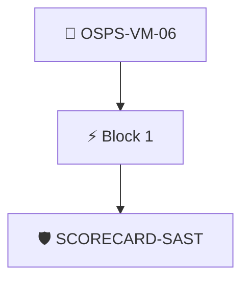

# Application Security Testing Enforced

The project MUST publish and enforce an application security testing policy, with a threshold for the remediation of SAST findings.

Checked through the attested OpenSSF Scorecard results with the `scorecard/sast` policy.

## Overview

| Property | Value |
|----------|-------|
| **Type** | PolicyGroup |
| **ID** | `OSPS-VM-06` |
| **Blocks** | 1 |
| **Enforce** | ON |

## Structure



## Block: `block-1` (assert: AND)

### Policy: `SCORECARD-SAST`

Checks the SAST score in a scorecard attestation

#### Overview

| Property | Value |
|----------|-------|
| **Type** | Policy |
| **ID** | `SCORECARD-SAST` |
| **Assert mode** | AND |
| **Tenets** | 1 |
| **Enforce** | ON |

#### Tenets

##### Tenet: `01-scorecard`

**Attestation types:**
- `https://scorecard.dev/result/v0.1`

**Evaluation:**
```cel
outputs.sast.all(c, c.score == 10)
```

**Outputs:**
- `sast`: `has(predicates[0].data.checks) ? predicates[0].data.checks.filter(c, c.name =...`

**On pass:** Scorecard detected a SAST tool

**On fail:** Scorecard did not detect a SAST tool
**Guidance:** Configure a SAST tool like CodeQL in your repo and reattest the scorecard


