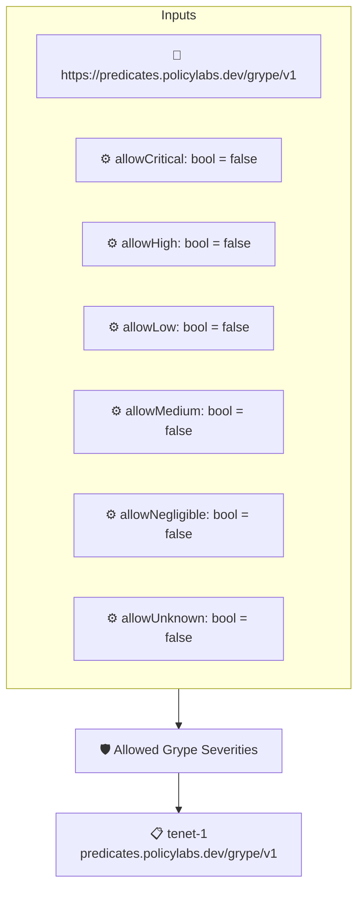

# Allowed Grype Severities

Passes an attested [grype](https://github.com/anchore/grype) vulnerability report only when every match has a severity the verifier explicitly allowed. Each severity has its own boolean context value, all off by default, so the policy fails on any finding unless its severity was enabled.

## Overview

| Property | Value |
|----------|-------|
| **Type** | Policy |
| **ID** | `grype-allow-severity` |
| **Assert mode** | AND |
| **Tenets** | 1 |
| **Enforce** | ON |

## Context Values

| Name | Type | Required | Default |
|------|------|----------|---------|
| `allowCritical` | bool | no | `false` |
| `allowHigh` | bool | no | `false` |
| `allowLow` | bool | no | `false` |
| `allowMedium` | bool | no | `false` |
| `allowNegligible` | bool | no | `false` |
| `allowUnknown` | bool | no | `false` |

## Structure



## Tenets

### Tenet: `tenet-1`

**Attestation types:**
- `https://predicates.policylabs.dev/grype/v1`

**Evaluation:**
```cel
outputs.disallowedCount == 0
```

**Outputs:**
- `disallowedCount`: `has(predicate.data.matches) ? size(predicate.data.matches.filter(m, !((m.vuln...`

**On pass:** All attested grype matches have an allowed severity

**On fail:** Attested grype report has {{ .Outputs.disallowedCount }} matches with a disallowed severity
**Guidance:** Remediate the vulnerabilities or enable their severity level via the allow* policy context values

