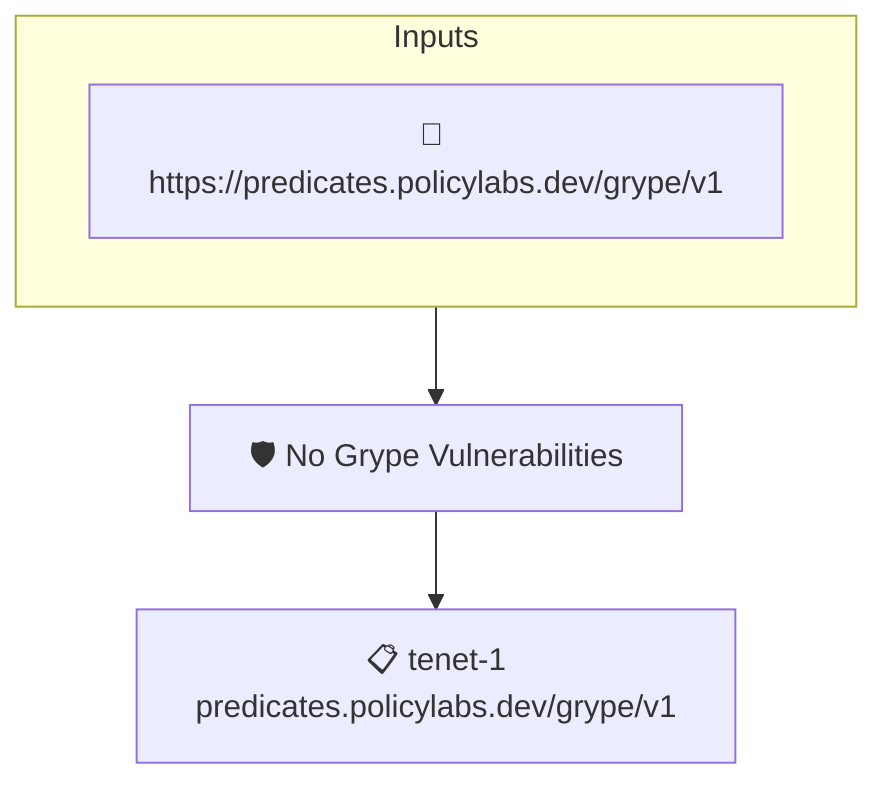

# No Grype Vulnerabilities

Checks that an attested [grype](https://github.com/anchore/grype) vulnerability report contains no vulnerability matches at all.

## Overview

| Property | Value |
|----------|-------|
| **Type** | Policy |
| **ID** | `grype-no-vulns` |
| **Assert mode** | AND |
| **Tenets** | 1 |
| **Enforce** | ON |

## Structure



## Tenets

### Tenet: `tenet-1`

**Attestation types:**
- `https://predicates.policylabs.dev/grype/v1`

**Evaluation:**
```cel
outputs.vulnCount == 0
```

**Outputs:**
- `vulnCount`: `has(predicate.data.matches) ? size(predicate.data.matches) : 0`

**On pass:** Attested grype report has no vulnerability matches

**On fail:** Attested grype report has {{ .Outputs.vulnCount }} vulnerability matches
**Guidance:** Remediate or suppress the vulnerabilities reported by grype before this policy can pass

