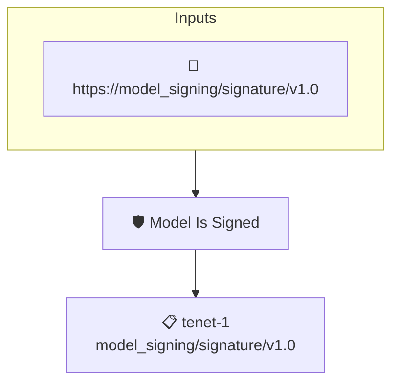

# Model Is Signed

Checks that an [OpenSSF Model Signing](https://github.com/ossf/model-signing-spec) attestation exists for the AI model under verification. Any OMS statement about the model counts; the policy does not inspect its contents.

Pair it with a signer identity to require that the signature comes from a trusted party.

## Overview

| Property | Value |
|----------|-------|
| **Type** | Policy |
| **ID** | `model-is-oms-signed` |
| **Assert mode** | AND |
| **Tenets** | 1 |
| **Enforce** | ON |

## Structure



## Tenets

### Tenet: `tenet-1`

**Attestation types:**
- `https://model_signing/signature/v1.0`

**Evaluation:**
```cel
size(predicates) > 0
```

**On pass:** Found model signature (OMS)

**On fail:** No model signature attestation found
**Guidance:** Sign the model using the model_signing utility

