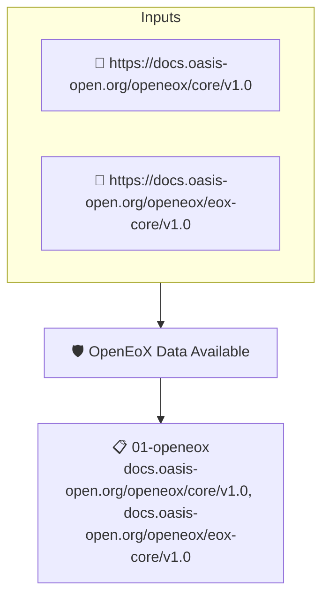

# OpenEoX Data Available

Checks that an [OpenEoX](https://github.com/openeox) attestation describing the end of life or end of support of the artifact is available. The policy only looks for the attestation; policies that read specific support dates can build on it.

## Overview

| Property | Value |
|----------|-------|
| **Type** | Policy |
| **ID** | `OPENEOX-EXISTS` |
| **Assert mode** | AND |
| **Tenets** | 1 |
| **Enforce** | ON |

## Structure



## Tenets

### Tenet: `01-openeox`

**Attestation types:**
- `https://docs.oasis-open.org/openeox/core/v1.0`
- `https://docs.oasis-open.org/openeox/eox-core/v1.0`

**Evaluation:**
```cel
size(predicates) > 0
```

**On pass:** Found an OpenEoX statement with the artifact's EOS.

**On fail:** No OpenEOX data found.
**Guidance:** Capture the project End of Support in an OpenEOX file.

