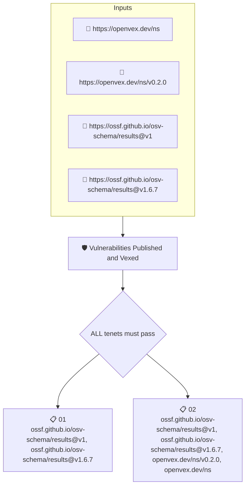

# Vulnerabilities Published and Vexed

Checks that the project publishes data about the vulnerabilities found in its code: an attested OSV vulnerability report exists and every finding in it is addressed by an OpenVEX statement.

## Overview

| Property | Value |
|----------|-------|
| **Type** | Policy |
| **ID** | `OPENVEX-VULNS-ARE-VEXED` |
| **Assert mode** | AND |
| **Tenets** | 2 |
| **Enforce** | ON |

## Structure



## Tenets

### Tenet: `01`

**Attestation types:**
- `https://ossf.github.io/osv-schema/results@v1`
- `https://ossf.github.io/osv-schema/results@v1.6.7`

**Evaluation:**
```cel
size(predicates) > 0
```

**On pass:** Vulnerability report published

**On fail:** A vulnerability report was found
**Guidance:** The artifact was published with an attested OSV results

### Tenet: `02`

**Attestation types:**
- `https://ossf.github.io/osv-schema/results@v1`
- `https://ossf.github.io/osv-schema/results@v1.6.7`
- `https://openvex.dev/ns/v0.2.0`
- `https://openvex.dev/ns`

**Evaluation:**
```cel
outputs.reports > 0 && (size(outputs.vulnerabilities) == 0 || outputs.vexes > 0)
```

**Outputs:**
- `reports`: `size(predicates.filter(p, p.predicate_type.contains('osv-schema')))`
- `vexes`: `size(predicates.filter(p, p.predicate_type.contains('openvex')))`
- `vulnerabilities`: `predicates.filter(p, p.predicate_type.contains('osv-schema')).map(p, p.data.r...`

**On pass:** No vulnerabilities and/or VEX data found

**On fail:** Unvexed vulnerabilities found
**Guidance:** All vulnerabilities must be patched or accounted in VEX documents

