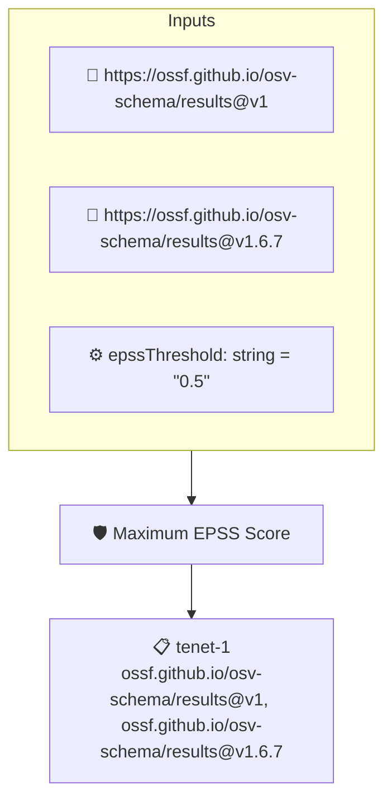

# Maximum EPSS Score

Fails when an attested OSV report contains a vulnerability with an EPSS score at or above the threshold (default 0.5)

## Overview

| Property | Value |
|----------|-------|
| **Type** | Policy |
| **ID** | `osv-max-epss` |
| **Assert mode** | AND |
| **Tenets** | 1 |
| **Enforce** | ON |

## Context Values

| Name | Type | Required | Default |
|------|------|----------|---------|
| `epssThreshold` | string | no | `0.5` |

## Structure



## Tenets

### Tenet: `tenet-1`

**Attestation types:**
- `https://ossf.github.io/osv-schema/results@v1`
- `https://ossf.github.io/osv-schema/results@v1.6.7`

**Evaluation:**
```cel
size(outputs.likelyExploited) == 0
```

**Outputs:**
- `likelyExploited`: `osv.vulns(predicate).filter(v, osv.epss(v) >= double(context.epssThreshold))....`

**On pass:** Attested OSV report contains no vulnerabilities at or above the EPSS threshold

**On fail:** Attested OSV report contains vulnerabilities at or above the EPSS threshold: {{ .Outputs.likelyExploited }}
**Guidance:** These vulnerabilities are likely to be exploited (high EPSS) — prioritize remediation, or raise the epssThreshold context value

