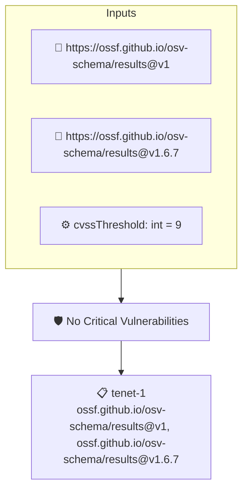

# No Critical Vulnerabilities

Ensures an attested OSV report contains no vulnerability at or above the CVSS threshold (default 9)

## Overview

| Property | Value |
|----------|-------|
| **Type** | Policy |
| **ID** | `osv-no-critical` |
| **Assert mode** | AND |
| **Tenets** | 1 |
| **Enforce** | ON |

## Context Values

| Name | Type | Required | Default |
|------|------|----------|---------|
| `cvssThreshold` | int | no | `9` |

## Structure



## Tenets

### Tenet: `tenet-1`

**Attestation types:**
- `https://ossf.github.io/osv-schema/results@v1`
- `https://ossf.github.io/osv-schema/results@v1.6.7`

**Evaluation:**
```cel
size(outputs.flaggedVulns) == 0
```

**Outputs:**
- `flaggedVulns`: `osv.vulns(predicate).filter(v, osv.cvss(v) >= double(context.cvssThreshold))....`

**On pass:** Attested OSV report has no vulnerability at or above the CVSS threshold

**On fail:** Attested OSV report contains vulnerabilities at or above the CVSS threshold: {{ .Outputs.flaggedVulns }}
**Guidance:** Remediate or suppress the flagged vulnerabilities, or raise the cvssThreshold context value

