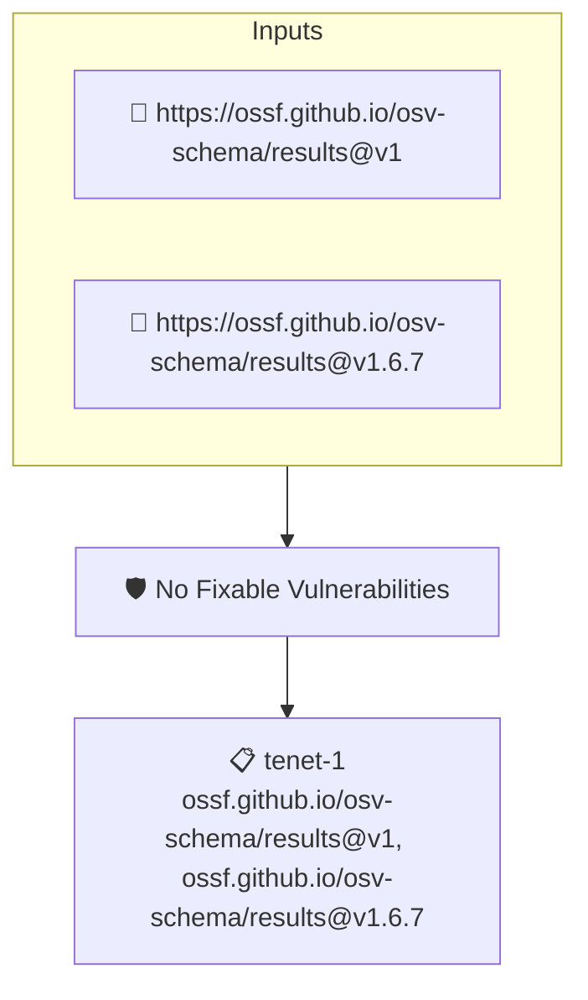

# No Fixable Vulnerabilities

Fails when an attested OSV report contains a vulnerability that already has a fix available

## Overview

| Property | Value |
|----------|-------|
| **Type** | Policy |
| **ID** | `osv-no-fixable` |
| **Assert mode** | AND |
| **Tenets** | 1 |
| **Enforce** | ON |

## Structure



## Tenets

### Tenet: `tenet-1`

**Attestation types:**
- `https://ossf.github.io/osv-schema/results@v1`
- `https://ossf.github.io/osv-schema/results@v1.6.7`

**Evaluation:**
```cel
size(outputs.fixable) == 0
```

**Outputs:**
- `fixable`: `osv.vulns(predicate).filter(v, osv.isFixed(v)).map(v, v.id)`

**On pass:** Attested OSV report contains no vulnerabilities with an available fix

**On fail:** Attested OSV report contains vulnerabilities with an available fix: {{ .Outputs.fixable }}
**Guidance:** These vulnerabilities already have fixed versions — upgrade the affected packages to remediate them

