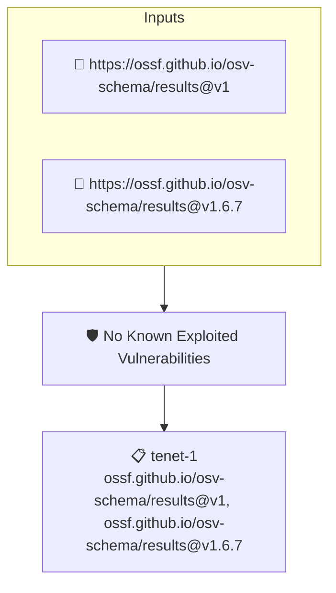

# No Known Exploited Vulnerabilities

Fails when an attested OSV report contains a known-exploited (KEV) vulnerability

## Overview

| Property | Value |
|----------|-------|
| **Type** | Policy |
| **ID** | `osv-no-known-exploited` |
| **Assert mode** | AND |
| **Tenets** | 1 |
| **Enforce** | ON |

## Structure



## Tenets

### Tenet: `tenet-1`

**Attestation types:**
- `https://ossf.github.io/osv-schema/results@v1`
- `https://ossf.github.io/osv-schema/results@v1.6.7`

**Evaluation:**
```cel
size(outputs.exploited) == 0
```

**Outputs:**
- `exploited`: `osv.vulns(predicate).filter(v, osv.isKEV(v)).map(v, v.id)`

**On pass:** Attested OSV report contains no known-exploited vulnerabilities

**On fail:** Attested OSV report contains known-exploited vulnerabilities: {{ .Outputs.exploited }}
**Guidance:** Known-exploited (KEV) vulnerabilities are being exploited in the wild — remediate them immediately

