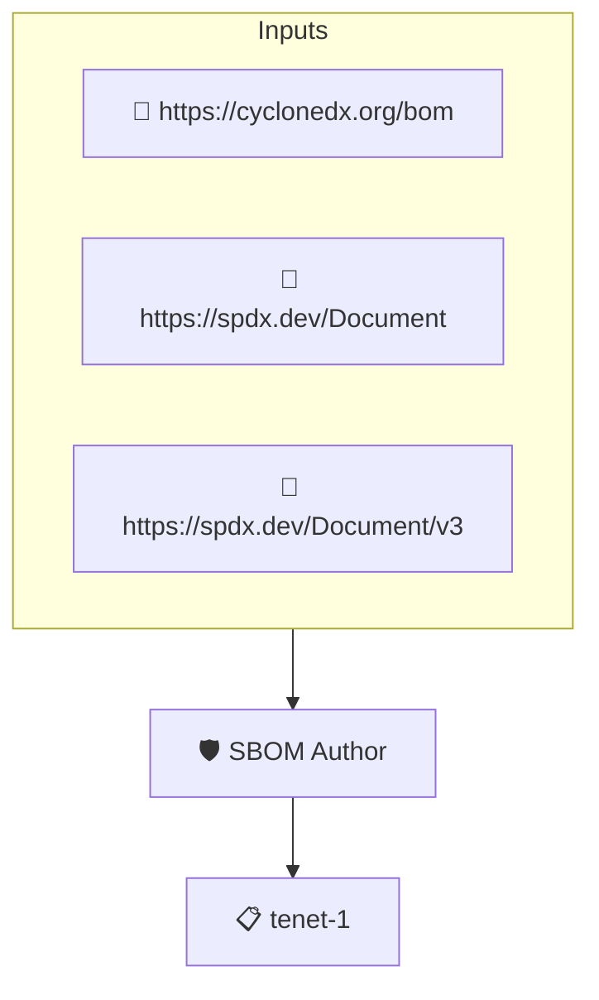

# SBOM Author

Checks that the SBOM names the author of the SBOM data. The SBOM is read through protobom, so SPDX and CycloneDX documents are handled alike.

## Overview

| Property | Value |
|----------|-------|
| **Type** | Policy |
| **ID** | `PROTOBOM-AUTHOR` |
| **Assert mode** | AND |
| **Tenets** | 1 |
| **Enforce** | ON |

## Structure



## Tenets

### Tenet: `tenet-1`

**Evaluation:**
```cel
size(outputs.authors) > 0
```

**Outputs:**
- `authors`: `size(sboms) > 0 ? sboms[0].get_authors() : []`

**On pass:** SBOM author defined

