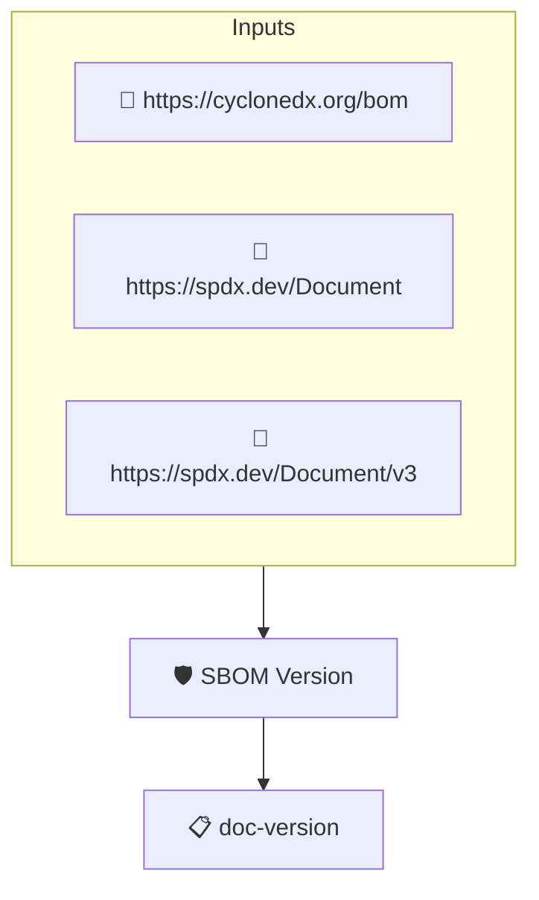

# SBOM Version

Checks that the SBOM document itself is versioned, either through
a version identifier or through a unique document identifier
(serial number). This implements the _SBOM Version_ element of the
CISA 2026 SBOM Minimum Elements, which admits both semantic
versions and RFC 9562 style unique identifiers.

CycloneDX captures this in the document `version` and
`serialNumber` fields, which must be stated explicitly: a document
that omits `version` is version 1 by the CycloneDX default, but it
does not identify its revision. SPDX 2 conveys it through the unique
document namespace, SPDX 3 through the `spdxId` of the document's
`SpdxDocument` element.

Not to be confused with PROTOBOM-SBOM-VERSIONS, which checks the
versions of the components listed in the SBOM.

## Overview

| Property | Value |
|----------|-------|
| **Type** | Policy |
| **ID** | `PROTOBOM-SBOM-DOC-VERSION` |
| **Assert mode** | AND |
| **Tenets** | 1 |
| **Enforce** | ON |

## Structure



## Tenets

### Tenet: `doc-version`

**Evaluation:**
```cel
outputs.version != '' || outputs.serial != '' || outputs.namespace != '' || outputs.spdxId != ''
```

**Outputs:**
- `namespace`: `size(predicates) > 0 && has(predicates[0].data.documentNamespace) ? predicate...`
- `serial`: `size(predicates) > 0 && has(predicates[0].data.serialNumber) ? predicates[0]....`
- `spdxId`: `size(predicates) > 0 && '@graph' in predicates[0].data ? (predicates[0].data[...`
- `version`: `size(predicates) > 0 && has(predicates[0].data.version) ? string(predicates[0...`

**On pass:** SBOM document is versioned

**On fail:** The SBOM document has no version or unique identifier
**Guidance:** Set the CycloneDX version/serialNumber, the SPDX 2 document namespace or the SPDX 3 SpdxDocument spdxId to identify this revision of the SBOM

