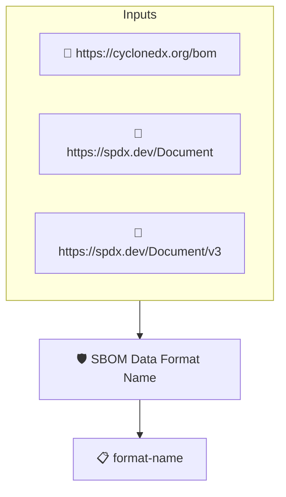

# SBOM Data Format Name

Checks that the SBOM is expressed in one of the widely used,
machine-processable SBOM data formats: SPDX or CycloneDX. This
implements the _SBOM Data Format Name_ element of the CISA 2026
SBOM Minimum Elements.

The format is read from the source data protobom captures when
ingesting the SBOM (for example `text/spdx+json;version=2.3`).

## Overview

| Property | Value |
|----------|-------|
| **Type** | Policy |
| **ID** | `PROTOBOM-SBOM-FORMAT-NAME` |
| **Assert mode** | AND |
| **Tenets** | 1 |
| **Enforce** | ON |

## Structure



## Tenets

### Tenet: `format-name`

**Evaluation:**
```cel
outputs.format.startsWith('text/spdx') || outputs.format.startsWith('application/vnd.cyclonedx')
```

**Outputs:**
- `format`: `size(sboms) > 0 ? sboms[0].get_metadata().source_data.format : ''`

**On pass:** SBOM data format identified

**On fail:** No SBOM in a widely used machine-processable data format was found
**Guidance:** Provide the SBOM as an SPDX or CycloneDX document

