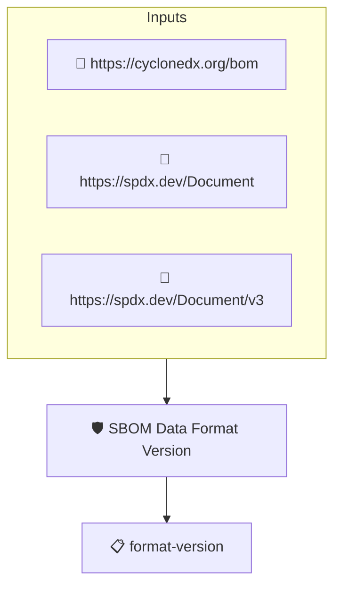

# SBOM Data Format Version

Checks that the version of the SBOM's data format can be
determined. This implements the _SBOM Data Format Version_ element
of the CISA 2026 SBOM Minimum Elements.

The version is read from the format string protobom captures when
ingesting the SBOM (for example `text/spdx+json;version=2.3` or
`application/vnd.cyclonedx+json;version=1.6`).

## Overview

| Property | Value |
|----------|-------|
| **Type** | Policy |
| **ID** | `PROTOBOM-SBOM-FORMAT-VERSION` |
| **Assert mode** | AND |
| **Tenets** | 1 |
| **Enforce** | ON |

## Structure



## Tenets

### Tenet: `format-version`

**Evaluation:**
```cel
outputs.format.contains(';version=') && !outputs.format.endsWith('=')
```

**Outputs:**
- `format`: `size(sboms) > 0 ? sboms[0].get_metadata().source_data.format : ''`

**On pass:** SBOM data format version identified

**On fail:** The version of the SBOM's data format could not be determined
**Guidance:** Generate the SBOM in a versioned release of SPDX or CycloneDX

