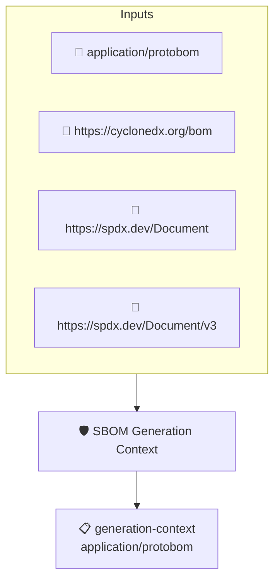

# SBOM Generation Context

Checks that the SBOM declares the software lifecycle phase it was
generated in (before build, build, after build, etc). This
implements the _SBOM Generation Context_ element of the CISA 2026
SBOM Minimum Elements.

CycloneDX captures this in `metadata.lifecycles`, which protobom
maps to the document types. SPDX 2.x has no equivalent field, so
SPDX documents are exempted from the check: the policy passes when
the SBOM is SPDX and requires at least one declared lifecycle
phase when it is CycloneDX.

This policy uses the protobom transformer because the lifecycle
data is only reachable through the transformed predicate.

## Overview

| Property | Value |
|----------|-------|
| **Type** | Policy |
| **ID** | `PROTOBOM-SBOM-GENERATION-CONTEXT` |
| **Assert mode** | AND |
| **Tenets** | 1 |
| **Enforce** | ON |

## Structure



## Tenets

### Tenet: `generation-context`

**Attestation types:**
- `application/protobom`

**Evaluation:**
```cel
outputs.format.startsWith('text/spdx') || size(outputs.lifecycles) > 0
```

**Outputs:**
- `format`: `size(predicates) > 0 && has(predicates[0].data.metadata.sourceData) ? predica...`
- `lifecycles`: `size(predicates) > 0 && has(predicates[0].data.metadata.documentTypes) ? pred...`

**On pass:** SBOM declares its generation context

**On fail:** The SBOM does not declare the lifecycle phase it was generated in
**Guidance:** Record the generation context in the CycloneDX metadata.lifecycles field (for example: build)

