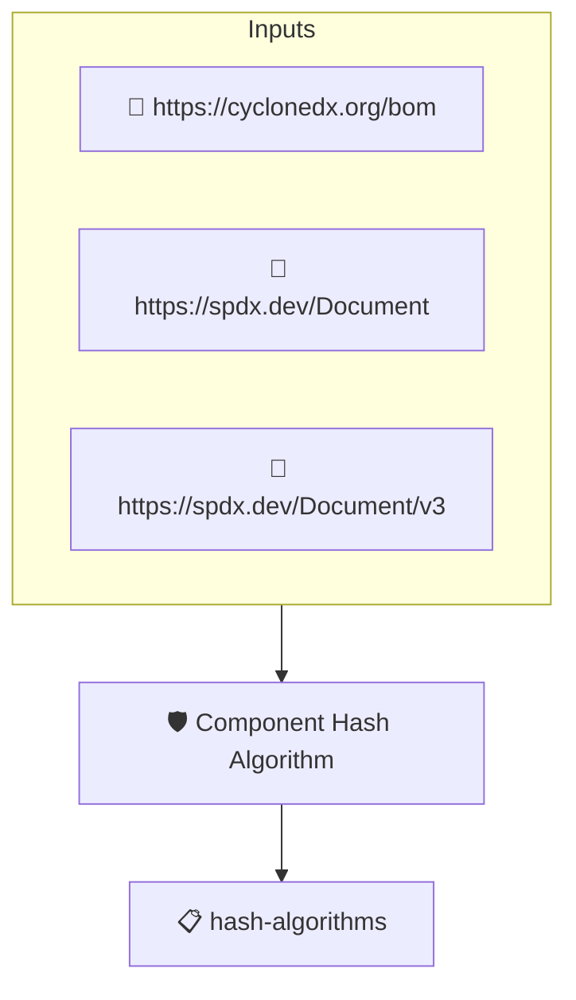

# Component Hash Algorithm

Checks that the hashes of the SBOM's top level components identify
the cryptographic algorithm that produced them. This implements
the _Component Hash Algorithm_ element of the CISA 2026 SBOM
Minimum Elements.

Protobom normalizes hash algorithm names when ingesting the SBOM,
so the check requires every hash entry to be keyed by a recognized
algorithm.

## Overview

| Property | Value |
|----------|-------|
| **Type** | Policy |
| **ID** | `PROTOBOM-SBOM-HASH-ALGORITHMS` |
| **Assert mode** | AND |
| **Tenets** | 1 |
| **Enforce** | ON |

## Structure



## Tenets

### Tenet: `hash-algorithms`

**Evaluation:**
```cel
size(outputs.hashes) > 0 && outputs.hashes.all(h, size(h) > 0 && h.all(alg, alg != 'UNKNOWN'))
```

**Outputs:**
- `hashes`: `size(sboms) > 0 ? sboms[0].get_node_list().get_root_nodes().map(n, n.hashes) ...`

**On pass:** All top level component hashes identify their algorithm

**On fail:** One or more top level components have no hash keyed by a recognized cryptographic algorithm
**Guidance:** Identify the hash algorithm of each component checksum using standard algorithm names (for example SHA256)

