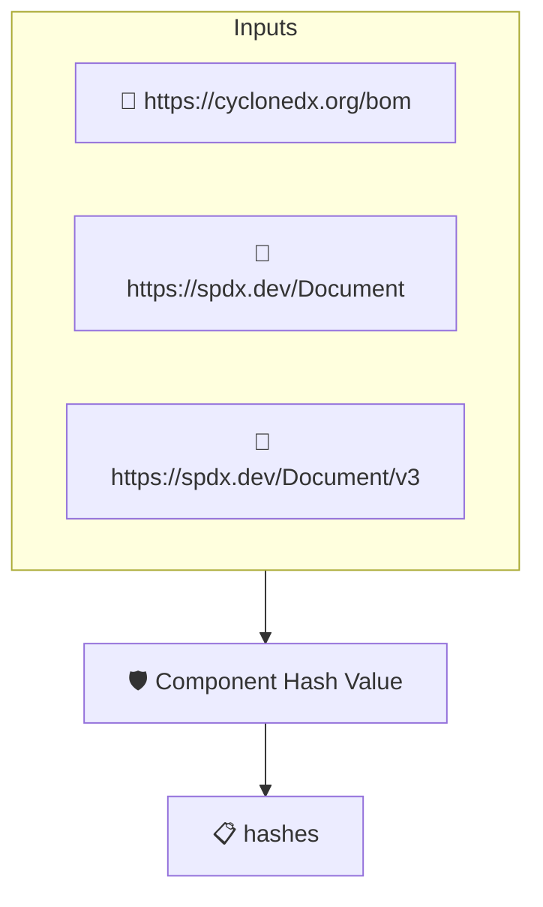

# Component Hash Value

Checks that the top level components of the SBOM carry at least
one cryptographic hash of the component artifact. This implements
the _Component Hash Value_ element of the CISA 2026 SBOM Minimum
Elements.

## Overview

| Property | Value |
|----------|-------|
| **Type** | Policy |
| **ID** | `PROTOBOM-SBOM-HASHES` |
| **Assert mode** | AND |
| **Tenets** | 1 |
| **Enforce** | ON |

## Structure



## Tenets

### Tenet: `hashes`

**Evaluation:**
```cel
size(outputs.hashes) > 0 && outputs.hashes.all(h, size(h) > 0 && h.all(alg, h[alg] != ''))
```

**Outputs:**
- `hashes`: `size(sboms) > 0 ? sboms[0].get_node_list().get_root_nodes().map(n, n.hashes) ...`

**On pass:** All top level components have hash values

**On fail:** One or more top level components have no cryptographic hash of the component artifact
**Guidance:** Add checksums (SPDX) or hashes (CycloneDX) to each top level component, or explicitly mark the hash as unknown

