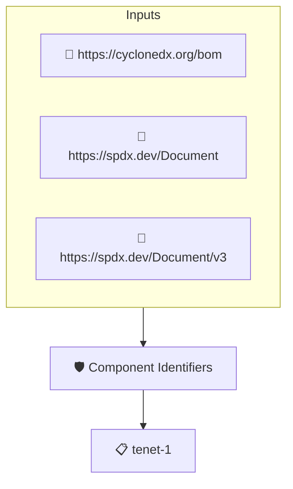

# Component Identifiers

Checks that every top-level component of the SBOM carries at least one software identifier, such as a package URL or a CPE. The SBOM is read through protobom, so SPDX and CycloneDX documents are handled alike.

## Overview

| Property | Value |
|----------|-------|
| **Type** | Policy |
| **ID** | `PROTOBOM-IDENTIFIERS` |
| **Assert mode** | AND |
| **Tenets** | 1 |
| **Enforce** | ON |

## Structure



## Tenets

### Tenet: `tenet-1`

**Evaluation:**
```cel
outputs.identifiers.all(s, size(s) > 0)
```

**Outputs:**
- `identifiers`: `sboms[0].get_node_list().get_root_nodes().map(n, n.identifiers)`

**On pass:** Top level components have software identifiers

